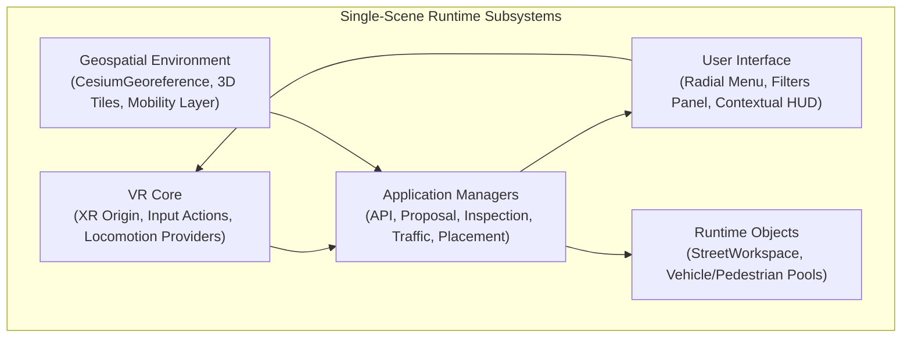
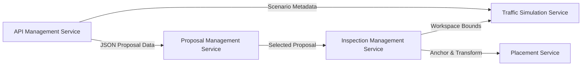
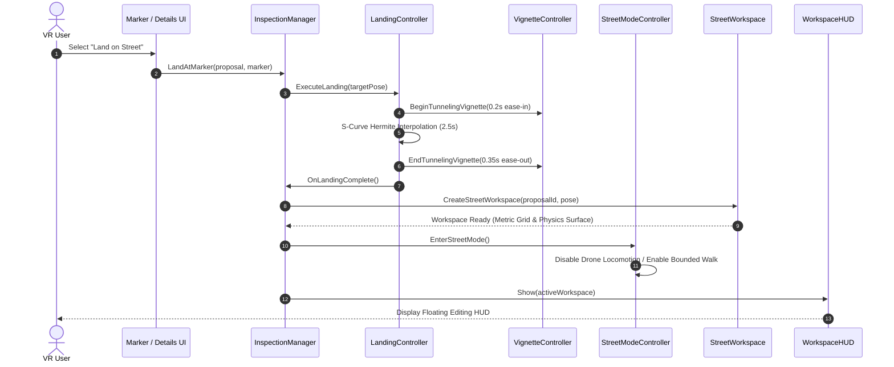

# System Architecture

The **BIO-INTEL-MOB Virtual Reality Platform** is engineered as a modular, single-scene runtime application. Rather than partitioning functionalities across multiple Unity scenes—which incurs disruptive loading delays, cache invalidation, and XR tracking discontinuities—all primary subsystems operate within a unified runtime context.

The architecture strictly adheres to the **separation of concerns** principle: each subsystem encapsulates a specific functional domain and communicates through well-defined service interfaces, events, and scriptable contracts.

---

## Single-Scene Subsystem Topology

Top-level scene GameObjects act as strict isolation barriers for each architectural layer:

| Subsystem | Primary Components | Architectural Responsibilities |
| :--- | :--- | :--- |
| **VR Core** | `XR Origin`, `Input Action Manager`, `XR References`, `Event System`, `Dynamic Move Provider`, `Snap Turn Provider`, `Teleportation Provider` | Initializes OpenXR runtimes, tracks stereoscopic head and hand poses, dispatches XR input actions, and manages active locomotion modes. |
| **Geospatial Environment** | `CesiumGeoreference`, `Cesium3DTileset`, `CesiumCreditSystem`, `Mobility Layer` | Manages WGS84-to-Unity coordinate transformation, streams Google Photorealistic 3D Tiles, dynamically manages Level of Detail (LOD) caches, and anchors urban assets. |
| **Application Managers** | `APIManager`, `ProposalManagementService`, `InspectionManager`, `TrafficSimulationService`, `PlacementManager` | Central service orchestrators executing business logic, networking, spatial transitions, state machines, and simulation control. |
| **User Interface** | `RadialMenuController`, `MarkerFilterPanelBuilder`, `ProposalDetailsPanel`, `WorkspaceHUD` | Renders world-space curved and planar canvases, dispatches filter predicates, and displays contextual spatial editing tools. |
| **Runtime Objects** | `StreetWorkspace_<id>`, `VehiclePool`, `PedestrianPool`, `SimulationAnchor` | Transient spatial containers and pooled GameObject instances created, recycled, and destroyed dynamically during user sessions. |

---

## Core Application Services

High-level application operations are coordinated through four central service managers:

### 1. API Management Service
The `APIManager` establishes asynchronous communication with the active pilot site's WordPress REST API (e.g., `https://rome.bio-intel-mob.eu/wp-json/api/datasets`).
- **Responsibilities**: HTTP request dispatching, JSON payload deserialization into strongly typed data models (`DatasetResponse`, `Proposal`), caching datasets, error handling, and offline fallback.
- **Architectural Isolation**: UI components and spatial markers never communicate directly with HTTP endpoints; all network calls route through this service.

### 2. Proposal Management Service
The `ProposalManagementService` coordinates the lifecycle of citizen proposals within the 3D world:
- **Marker Spawning**: Instantiates `ProposalMarker` GameObjects at geographic coordinates $(\phi, \lambda, h)$, using `CesiumGeoreference` to position them accurately in Unity world space.
- **Visual Composition**: Each proposal entity includes a ground anchor, vertical beacon cylinder, status glyph, and interaction collider.
- **Filtering Pipeline**: Synchronizes with the `MarkerFiltersController` to apply real-time client-side predicates (Category, Status, Severity) across all active markers without round-tripping to the server.
- **Lifecycle Sequence**:

> [!NOTE]
> **Engineering Decision**: Separating proposal retrieval (`APIManager`) from proposal instantiation (`ProposalManagementService`) decouples network protocols from rendering logic. This allows caching, offline simulations, or alternative backend migrations without altering 3D marker code.

### 3. Inspection Management Service
The `InspectionManager` orchestrates the operational transition between high-altitude city overview exploration and fine-grained street-level co-design. It manages:
- **`LandingController`**: Computes an obstacle-free landing target $\vec{P}_{\text{target}}$ offset by pedestrian eye-height ($1.7\,\text{m}$), then executes an S-curve Hermite position/rotation interpolation over $2.5\,\text{s}$.
- **`DynamicTunnelingVignette`**: Constricts peripheral FOV during rapid motion to mitigate sensory conflict and visual-vestibular mismatch.
- **`StreetModeController`**: Reconfigures locomotion by disabling continuous aerial drone flying and enabling bounded walking, snap turning, and teleportation.
- **`StreetWorkspace`**: Programmatically synthesizes a localized spatial container (`StreetWorkspace_<proposalId>`) containing dedicated physics layers, metric grids, snap points, and asset roots.

### 4. Traffic Simulation Service
The `TrafficSimulationService` links the Unity VR client with external **SUMO (Simulation of Urban MObility)** instances:
- **`SumoLauncher`**: Handles background process execution of the headless SUMO CLI, configuring network files (`.net.xml`) and routes (`.rou.xml`).
- **`UdpReceiver`**: Dedicated background C# socket thread receiving high-frequency state frames without blocking Unity's rendering thread.
- **`MainThreadDispatcher`**: Safely marshals received packet data back onto Unity's main thread.
- **`SumoGeoConverter`**: Translates SUMO Cartesian network offsets $(x_{\text{sumo}}, y_{\text{sumo}})$ into WGS84 coordinates and subsequently into Unity world coordinates.
- **`VehiclePool` & `PedestrianPool`**: Zero-allocation object pools that recycle vehicle and pedestrian meshes, ensuring consistent 90 FPS VR performance.

### 5. Placement & Asset Inventory Service
The `PlacementManager` governs interactive urban co-design:
- **Data Catalog**: Backed by ScriptableObject registries (`InventoryDatabase`, `PlaceableDefinition`).
- **Dynamic Collider Synthesis**: Automatically inspects catalog prefabs and constructs synthetic box/mesh colliders and outline shaders if not authored in the raw asset.
- **Transactional Editing**: Implements two-phase placement (raycast ghost preview vs. committed placement) with full rollback support on cancellation.

---

## End-to-End Inspection Sequence

The following sequence diagram illustrates how these services cooperate when a user investigates a proposal:

---

## Architectural Principles & Extensibility

1. **Deterministic Coordinate Precision**: Because large-scale geospatial coordinates can induce 32-bit floating-point jitter, all geographic conversions rely on double-precision (`double3`) ellipsoidal transformations before projecting into Unity's camera-relative coordinate space.
2. **Strict Layer Decoupling**: Visual 3D Tiles streamed from Google/Cesium are kept strictly isolated from physics raycast surfaces. Collision and placement logic rely on curated workspace planes assigned to the dedicated `StreetWorkspaceSurface` layer.
3. **Allocation-Free Runtime Loop**: In high-density scenes with moving traffic, no dynamic `Instantiate()` or `Destroy()` calls are permitted during the simulation update loop; all entities are recycled via pre-warmed object pools.
