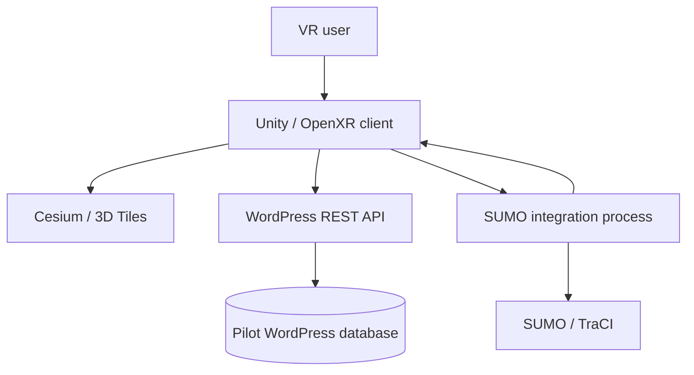

# System architecture

BIO-INTEL-MOB uses a **Unity VR client**, **pilot-specific WordPress REST APIs**, a **Cesium geospatial layer**, and a **SUMO-based simulation pipeline**. The earlier Spring Boot backend has been retired; it is **not** an active runtime dependency.

## System boundaries

| Layer | Responsibilities |
| --- | --- |
| Unity + OpenXR | UI, VR interactions, city navigation, proposal rendering, inspection tools |
| Cesium | Georeferencing and streaming geospatial tile content |
| WordPress REST APIs | Serving pilot-site proposals and related application data |
| WordPress databases | Pilot-specific persistence managed by corresponding WordPress installations |
| SUMO integration | Traffic/pedestrian scenario execution and frame transfer to the visualization client |

## Deployment warning

Localhost-based simulation streaming may work in Editor testing but **is not directly usable as a remote VR headset deployment**. Production networking, authorization, service deployment, and simulation session lifecycle need explicit design and verification.

## Data ownership

Persisted 3D placement proposals require an explicit WordPress data model and authenticated write endpoints; they should not be assumed to exist merely because the client can place an object in a scene.
