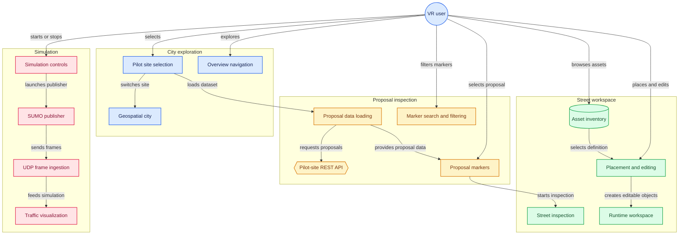
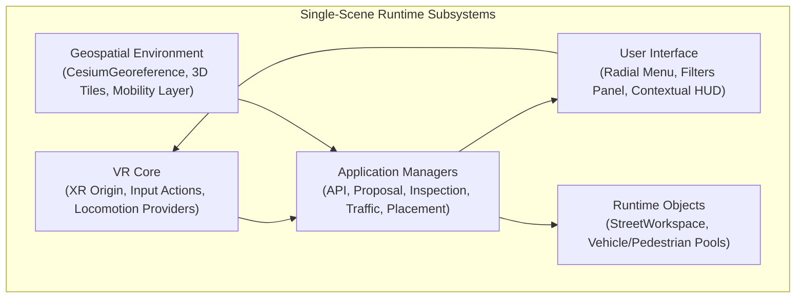
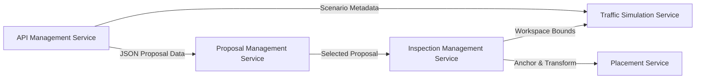
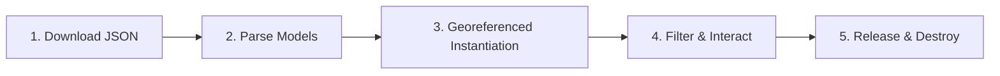
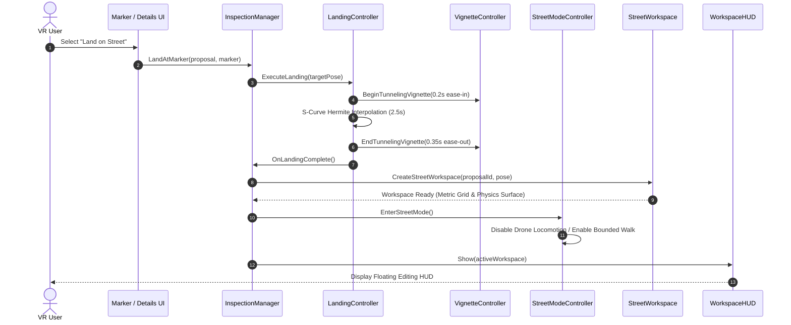

# System architecture

## Architecture reference

The architecture connects VR navigation and the geospatial world with planning workflows and the SUMO simulation bridge.

<Frame caption="Architecture reference: VR navigation, geospatial services, planning workflows, and mobility simulation.">
  
</Frame>

[Open the full-resolution reference image](/architecture/diagram.png).

The image is a conceptual reference. Citizen feedback, urban proposal creation, and mobility analytics describe the planning context; their inclusion does not confirm implementation. The project workflow covers city exploration, proposal inspection, workspace editing, and traffic visualization.

## Project workflow architecture

The project's GitDiagram architecture view groups workflows into city exploration, proposal inspection, street workspace, and simulation. Selected nodes link to the corresponding repository folders or bridge script.

| Workflow | Main flow | Detailed documentation |
| :--- | :--- | :--- |
| City exploration (blue) | Select a pilot site, switch the geospatial city, and navigate the overview. | [Geospatial & 3D Tiles](/geospatial/cesium), [Unity VR & Interaction](/unity-vr/overview) |
| Proposal inspection (amber) | Load proposals from the pilot-site REST API, search and filter markers, and select a proposal to inspect. | [WordPress Backend](/backend/wordpress), [API Reference](/api-reference/overview) |
| Street workspace (green) | Inspect the street, browse the asset inventory, and place or edit objects in the runtime workspace. | [Street Inspection & Co-Design](/inspection/street-inspection) |
| Simulation (rose) | Start or stop the SUMO publisher, receive UDP frames, and visualize traffic. | [SUMO Traffic Simulation](/simulation/sumo) |

## Runtime subsystem architecture

The BIO-INTEL-MOB Virtual Reality Platform runs its primary subsystems in a single Unity scene. This modular runtime avoids the loading delays, cache invalidation, and XR tracking discontinuities associated with switching scenes.

Each subsystem owns a specific functional domain and communicates through service interfaces, events, and scriptable contracts.

## Single-scene subsystem topology

Top-level scene GameObjects separate the architectural layers:

| Subsystem | Primary Components | Architectural Responsibilities |
| :--- | :--- | :--- |
| VR Core | `XR Origin`, `Input Action Manager`, `XR References`, `Event System`, `Dynamic Move Provider`, `Snap Turn Provider`, `Teleportation Provider` | Initializes OpenXR runtimes, tracks stereoscopic head and hand poses, dispatches XR input actions, and manages active locomotion modes. |
| Geospatial Environment | `CesiumGeoreference`, `Cesium3DTileset`, `CesiumCreditSystem`, `Mobility Layer` | Converts WGS84 coordinates to Unity coordinates, streams Google Photorealistic 3D Tiles, manages Level of Detail (LOD) caches, and anchors urban assets. |
| Application Managers | `APIManager`, `ProposalManagementService`, `InspectionManager`, `TrafficSimulationService`, `PlacementManager` | Coordinates business logic, networking, spatial transitions, state machines, and simulation control. |
| User Interface | `RadialMenuController`, `MarkerFilterPanelBuilder`, `ProposalDetailsPanel`, `WorkspaceHUD` | Renders world-space curved and planar canvases, dispatches filter predicates, and displays contextual spatial editing tools. |
| Runtime Objects | `StreetWorkspace_<id>`, `VehiclePool`, `PedestrianPool`, `SimulationAnchor` | Creates, recycles, and destroys transient spatial containers and pooled GameObject instances during user sessions. |

## Core application services

Five services coordinate application operations:

### 1. API management service

The `APIManager` communicates asynchronously with the active pilot site's WordPress REST API, such as `https://rome.bio-intel-mob.eu/wp-json/api/datasets`.

- Responsibilities: Dispatches HTTP requests, deserializes JSON into strongly typed models (`DatasetResponse`, `Proposal`), caches datasets, handles errors, and provides offline fallback.

- Architectural Isolation: UI components and spatial markers route all HTTP calls through this service.

### 2. Proposal management service

The `ProposalManagementService` manages citizen proposals in the 3D world:

- Marker Spawning: Creates `ProposalMarker` GameObjects at geographic coordinates $(\phi, \lambda, h)$, using `CesiumGeoreference` to position them accurately in Unity world space.

- Visual Composition: Each proposal entity includes a ground anchor, vertical beacon cylinder, status glyph, and interaction collider.

- Filtering Pipeline: Works with the `MarkerFiltersController` to filter active markers locally by Category, Status, and Severity in real time, without additional server requests.

- Lifecycle Sequence:

> [!NOTE]
> Proposal retrieval (`APIManager`) and instantiation (`ProposalManagementService`) are separate, keeping network protocols independent of rendering. Caching, offline simulations, and backend migrations can therefore change without altering 3D marker code.

### 3. Inspection management service

The `InspectionManager` handles transitions between high-altitude city exploration and street-level co-design. It manages:

- `LandingController`: Computes an obstacle-free landing target $\vec{P}_{\text{target}}$ offset by pedestrian eye-height ($1.7\,\text{m}$), then executes an S-curve Hermite position/rotation interpolation over $2.5\,\text{s}$.

- `DynamicTunnelingVignette`: Narrows peripheral FOV during rapid motion to reduce sensory conflict and visual-vestibular mismatch.

- `StreetModeController`: Reconfigures locomotion by disabling continuous aerial drone flying and enabling bounded walking, snap turning, and teleportation.

- `StreetWorkspace`: Creates a local spatial container at runtime (`StreetWorkspace_<proposalId>`) containing dedicated physics layers, metric grids, snap points, and asset roots.

### 4. Traffic simulation service

The `TrafficSimulationService` connects the Unity VR client to external SUMO (Simulation of Urban MObility) instances:

- `SumoLauncher`: Runs the headless SUMO CLI as a background process and configures network files (`.net.xml`) and routes (`.rou.xml`).

- `UdpReceiver`: Receives high-frequency state frames on a dedicated background C# socket thread without blocking Unity rendering.

- `MainThreadDispatcher`: Safely passes received packet data to Unity's main thread.

- `SumoGeoConverter`: Converts SUMO Cartesian network offsets $(x_{\text{sumo}}, y_{\text{sumo}})$ into WGS84 coordinates and then Unity world coordinates.

- `VehiclePool` & `PedestrianPool`: Recycle vehicle and pedestrian meshes through zero-allocation object pools for consistent 90 FPS VR performance.

### 5. Placement & asset inventory service

The `PlacementManager` manages interactive urban co-design:

- Data Catalog: Uses ScriptableObject registries (`InventoryDatabase`, `PlaceableDefinition`).

- Dynamic Collider Synthesis: Inspects catalog prefabs and creates box/mesh colliders and outline shaders when the source asset lacks them.

- Transactional Editing: Uses two-phase placement, with a raycast ghost preview followed by committed placement, and fully rolls back canceled changes.

## End-to-end inspection sequence

When a user investigates a proposal, the services follow this sequence:

## Architectural principles & extensibility

1. Deterministic Coordinate Precision: Large geospatial coordinates can cause 32-bit floating-point jitter. All geographic conversions use double-precision (`double3`) ellipsoidal transformations before projection into Unity's camera-relative coordinate space.
2. Strict Layer Decoupling: Visual 3D Tiles streamed from Google/Cesium are separate from physics raycast surfaces. Collision and placement use curated workspace planes on the dedicated `StreetWorkspaceSurface` layer.
3. Allocation-Free Runtime Loop: In high-density traffic scenes, the simulation update loop recycles all entities through pre-warmed object pools. It does not call `Instantiate()` or `Destroy()` dynamically.
