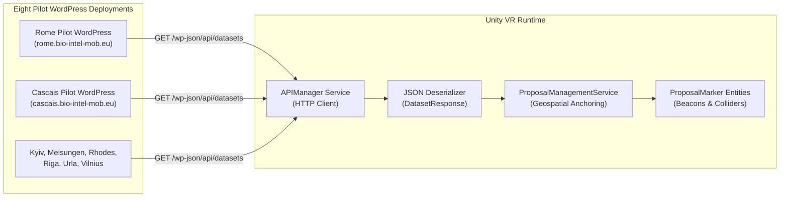
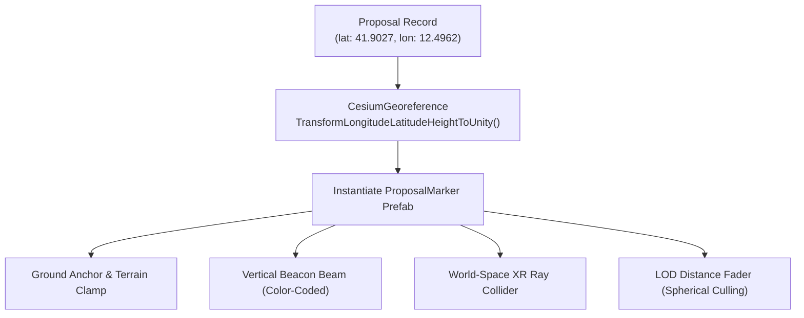
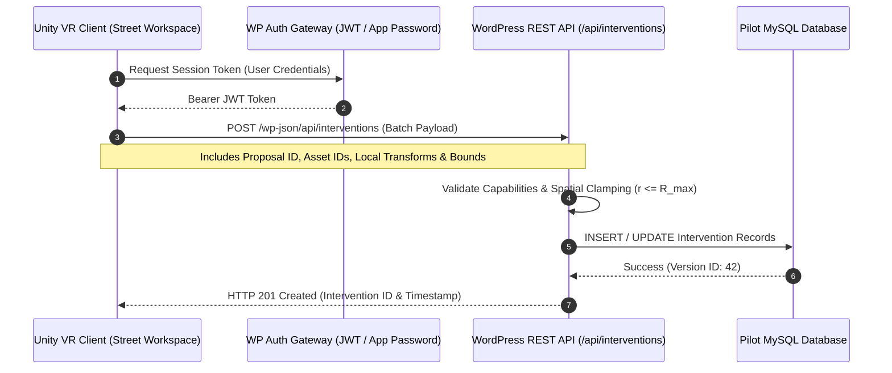

# WordPress backend & proposal management

The BIO-INTEL-MOB Backend Subsystem stores data, aggregates civic proposals, and delivers datasets for each participating municipality.

Each pilot site has a WordPress REST API tailored to its administrative infrastructure. These lightweight, content-managed endpoints replace the retired monolithic Spring Boot backend.

The eight pilots are Cascais, Kyiv, Melsungen, Rhodes, Riga, Rome, Urla, and Vilnius. The [API reference](/api-reference/overview) lists their URLs and groups the available endpoints by pilot name.



## Architectural principles & pilot isolation

1. Autonomous Pilot Instances: Each municipality operates an independent WordPress installation, such as `rome.bio-intel-mob.eu`, with its own database.
2. Standardized REST Taxonomy: Pilot deployments expose standardized endpoints under `/wp-json/api/`. The Unity VR client switches cities by updating its base URL.
3. CORS & Preflight Handling: The WordPress servers support Cross-Origin Resource Sharing (CORS) for web-based API testing and browser developer tools:
   ```http
   Access-Control-Allow-Origin: <Request-Origin>
   Access-Control-Allow-Methods: OPTIONS, GET, POST, PUT, PATCH, DELETE
   Access-Control-Allow-Credentials: true
   Vary: Origin
   ```

## Civic proposal data model & retrieval

At startup and when the user switches cities, the `APIManager` sends an asynchronous HTTP request:

```http
GET https://rome.bio-intel-mob.eu/wp-json/api/datasets
```

### JSON response schema

The response contains batch metadata and geolocated citizen proposals:

```json
{
  "id": 1,
  "city": "Rome",
  "generatedAt": "2026-10-19T10:38:40+00:00",
  "proposals": [
    {
      "id": 314,
      "title": "Test - Repubblica",
      "description": "Pedestrian safety improvement needed at crossing near Piazza della Repubblica.",
      "latitude": 41.902706261321526,
      "longitude": 12.496237461082446,
      "category": "TRANSPORT",
      "votes": 142,
      "status": "PENDING",
      "severity": "HIGH",
      "date": "2026-10-08",
      "images": [
        "https://rome.bio-intel-mob.eu/wp-content/uploads/2026/10/images-27.jpeg"
      ],
      "video": null
    }
  ]
}
```

### Proposal taxonomy

- Categories:
  - `TRANSPORT`: Public transit delays, bicycle lane deficits, bus stop placement.
  - `ENVIRONMENT`: Air quality, urban heat islands, lack of green canopy.
  - `ACCESSIBILITY`: Wheelchair obstructions, high curbs, broken ramps.
  - `INFRASTRUCTURE`: Road surface degradation, potholes, sidewalk fractures.

- Severity Levels: `LOW`, `MEDIUM`, `HIGH`. Determines beacon color intensity and sorting priority in the UI filter matrix.

- Resolution States: `PENDING`, `APPROVED`, `REJECTED`. Reflects the municipal administration's formal review state.

## Geospatial anchoring & marker lifecycle in Unity

After the JSON is deserialized, the `ProposalManagementService` creates a `ProposalMarker` entity for each entry:



### Marker subcomponents

1. Ground Anchor: Uses a downward raycast against the active elevation mesh to anchor markers to sloped terrain.
2. Vertical Beacon Cylinder: A translucent, high-visibility light column rises $50\,\text{m}$ above the terrain so users can spot proposals from orbital drone altitudes.
3. Category Glyph: A 3D floating icon indicating the proposal type (*Transport*, *Greenery*, etc.).
4. Distance-Based LOD Culling: When the user is flying at high altitudes ($> 1\,500\,\text{m}$), individual labels and colliders are disabled. Only the lightweight beacon column is rendered to keep GPU draw calls within budget.

## Intervention persistence architecture (roadmap contract)

Proposal retrieval is operational. Saving 3D street furniture placed during inspection sessions requires the proposed versioned persistence contract described here.



### Proposed persistence payload specification
```json
{
  "proposalId": 314,
  "authorId": "usr_9921",
  "clientVersion": "2.4.0",
  "workspaceAnchor": {
    "latitude": 41.902706,
    "longitude": 12.496237,
    "elevation": 54.2
  },
  "placedObjects": [
    {
      "assetId": "furniture_bollard_steel_01",
      "localPosition": { "x": 3.42, "y": 0.0, "z": -1.15 },
      "localRotation": { "x": 0.0, "y": 0.7071, "z": 0.0, "w": 0.7071 },
      "localScale": { "x": 1.0, "y": 1.0, "z": 1.0 },
      "metadata": {
        "costEstimate": 250.0,
        "trafficImpact": "lane_restriction"
      }
    }
  ]
}
```

### Architectural safeguards

- Anchor-Local Invariance: Transforms are stored relative to the proposal's local coordinate frame $(x_{\text{local}}, y_{\text{local}}, z_{\text{local}})$, so changes to global city georeferencing or tile elevation preserve furniture placement relative to the anchor.

- Optimistic Locking: Interventions include a `versionToken` so concurrent inspection sessions cannot overwrite community designs without conflict resolution.

- Spatial Validation: The backend checks that all object positions stay within the municipal workspace boundary radius ($r \le R_{\text{max}}$).
