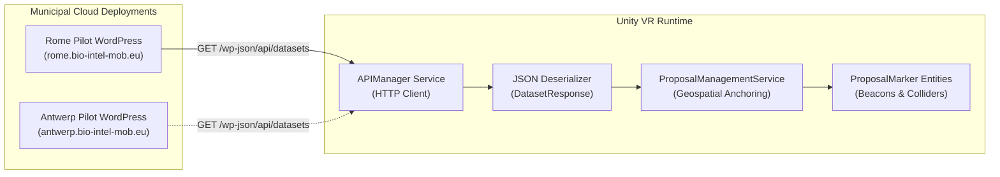
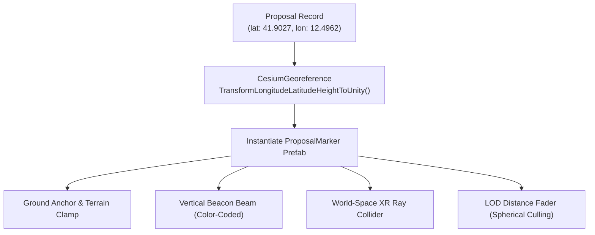
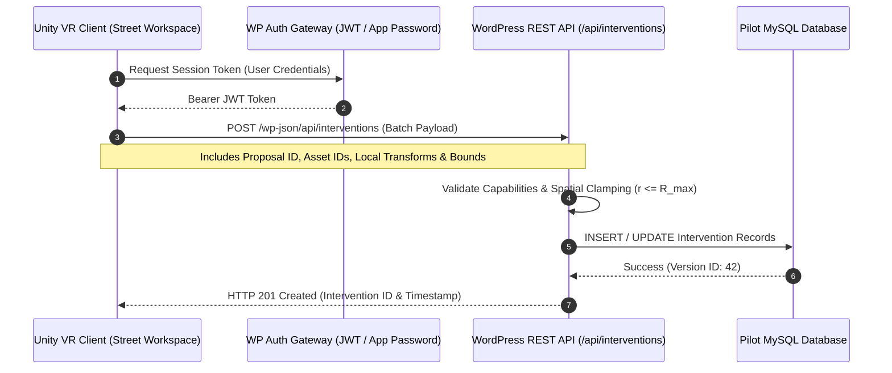

# WordPress Backend & Proposal Management

The **BIO-INTEL-MOB Backend Subsystem** provides centralized persistence, civic proposal aggregation, and dataset delivery for each participating municipality. 

The architecture uses **pilot-specific WordPress REST APIs**. The earlier monolithic Spring Boot backend has been retired in favor of lightweight, content-managed endpoints tailored to each pilot site's administrative infrastructure.



---

## Architectural Principles & Pilot Isolation

1. **Autonomous Pilot Instances**: Rather than coupling multiple European cities into a single global database, each municipality operates its own independent WordPress installation (e.g., `rome.bio-intel-mob.eu`).
2. **Standardized REST Taxonomy**: All pilot deployments expose standardized endpoints under `/wp-json/api/`, ensuring that the Unity VR client can switch cities dynamically simply by updating its base URL.
3. **CORS & Preflight Handling**: To facilitate web-based API testing and browser-based developer tooling, the WordPress servers support full Cross-Origin Resource Sharing (CORS):
   ```http
   Access-Control-Allow-Origin: *
   Access-Control-Allow-Methods: OPTIONS, GET, POST, PUT, PATCH, DELETE
   Access-Control-Allow-Credentials: true
   Vary: Origin
   ```

---

## Civic Proposal Data Model & Retrieval

During application startup or when switching cities, the `APIManager` initiates an asynchronous HTTP request:

```http
GET https://rome.bio-intel-mob.eu/wp-json/api/datasets
```

### JSON Response Schema
The response payload contains batch metadata and a collection of geolocated citizen proposals:

```json
{
  "id": 1,
  "city": "Rome",
  "generatedAt": "2026-10-19T10:38:40+00:00",
  "proposals": [
    {
      "id": 314,
      "title": "Test - Repubblica",
      "description": "Pedestrian safety improvement needed at crossing near Piazza della Repubblica.",
      "latitude": 41.902706261321526,
      "longitude": 12.496237461082446,
      "category": "TRANSPORT",
      "votes": 142,
      "status": "PENDING",
      "severity": "HIGH",
      "date": "2026-10-08",
      "images": [
        "https://rome.bio-intel-mob.eu/wp-content/uploads/2026/10/images-27.jpeg"
      ],
      "video": null
    }
  ]
}
```

### Proposal Taxonomy
- **Categories**:
  - `TRANSPORT`: Public transit delays, bicycle lane deficits, bus stop placement.
  - `ENVIRONMENT`: Air quality, urban heat islands, lack of green canopy.
  - `ACCESSIBILITY`: Wheelchair obstructions, high curbs, broken ramps.
  - `INFRASTRUCTURE`: Road surface degradation, potholes, sidewalk fractures.
- **Severity Levels**: `LOW`, `MEDIUM`, `HIGH`. Determines beacon color intensity and sorting priority in the UI filter matrix.
- **Resolution States**: `PENDING`, `APPROVED`, `REJECTED`. Reflects the municipal administration's formal review state.

---

## Geospatial Anchoring & Marker Lifecycle in Unity

Once JSON data is unmarshalled, the `ProposalManagementService` instantiates a `ProposalMarker` entity for each entry:



### Marker Subcomponents
1. **Ground Anchor**: Binds to the terrain using a downward raycast against the active elevation mesh to prevent markers from floating above slopes.
2. **Vertical Beacon Cylinder**: A high-visibility translucent light column rising $50\,\text{m}$ above the terrain, ensuring proposals can be spotted from orbital drone altitudes.
3. **Category Glyph**: A 3D floating icon indicating the proposal type (*Transport*, *Greenery*, etc.).
4. **Distance-Based LOD Culling**: When the user is flying at high altitudes ($> 1\,500\,\text{m}$), individual labels and colliders are disabled, rendering only the lightweight beacon column to maintain optimal GPU draw-call budgets.

---

## Intervention Persistence Architecture (Roadmap Contract)

While proposal retrieval is fully operational, saving interactive 3D street furniture placed during inspection sessions requires a versioned persistence contract.



### Proposed Persistence Payload Specification
```json
{
  "proposalId": 314,
  "authorId": "usr_9921",
  "clientVersion": "2.4.0",
  "workspaceAnchor": {
    "latitude": 41.902706,
    "longitude": 12.496237,
    "elevation": 54.2
  },
  "placedObjects": [
    {
      "assetId": "furniture_bollard_steel_01",
      "localPosition": { "x": 3.42, "y": 0.0, "z": -1.15 },
      "localRotation": { "x": 0.0, "y": 0.7071, "z": 0.0, "w": 0.7071 },
      "localScale": { "x": 1.0, "y": 1.0, "z": 1.0 },
      "metadata": {
        "costEstimate": 250.0,
        "trafficImpact": "lane_restriction"
      }
    }
  ]
}
```

### Architectural Safeguards
- **Anchor-Local Invariance**: Transformations are stored relative to the proposal's local coordinate frame $(x_{\text{local}}, y_{\text{local}}, z_{\text{local}})$, ensuring that changes in global city georeferencing or tile elevation do not corrupt the relative placement of furniture.
- **Optimistic Locking**: Interventions include a `versionToken` to prevent concurrent inspection sessions from overwriting simultaneous community designs without conflict resolution.
- **Spatial Validation**: The backend validates that all object positions fall strictly within the municipal workspace boundary radius ($r \le R_{\text{max}}$).
