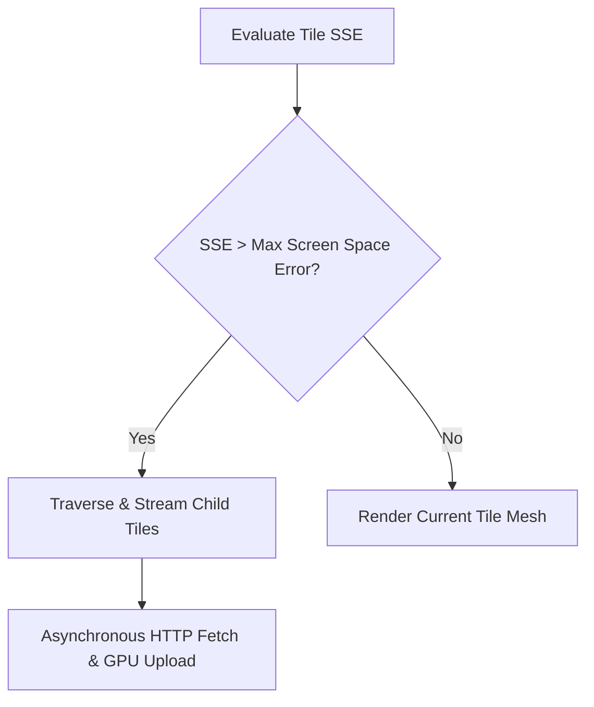
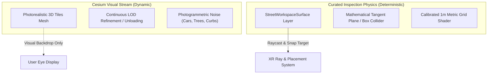

# Geospatial Integration & 3D Tiles

The **Geospatial Subsystem** in BIO-INTEL-MOB provides the digital representation of real-world cities upon which proposals, inspection workspaces, and traffic simulations operate. 

It combines **Cesium for Unity** with **Google Photorealistic 3D Tiles** to stream high-fidelity, georeferenced urban models directly into the Unity runtime.

```mermaid
flowchart LR
    WGS[WGS84 Coordinates\n(Latitude, Longitude, Height)] --> ECEF[ECEF Cartesian Frame\n(Earth-Centered Earth-Fixed)]
    ECEF --> ENU[Local Tangent Plane\n(East, North, Up)]
    ENU --> Unity[Unity World Space\n(+X=East, +Y=Up, +Z=North)]
    Cesium[CesiumGeoreference\nDouble-Precision Rebasing] --> Unity
    Tiles[Google Photorealistic 3D Tiles\nHierarchical BVH & SSE Streaming] --> Unity
```

---

## Coordinate Systems & Georeferencing

Real-world geospatial data and virtual reality game engines operate under fundamentally different spatial models:

### 1. WGS84 Ellipsoidal Coordinates
Geographic coordinates are defined by the **World Geodetic System 1984 (WGS84)**:
- Latitude ($\phi$): Angular distance north or south of the Equator $[-90^\circ, +90^\circ]$.
- Longitude ($\lambda$): Angular distance east or west of the Prime Meridian $[-180^\circ, +180^\circ]$.
- Ellipsoidal Height ($h$): Distance in meters measured along the ellipsoidal normal above or below the WGS84 reference ellipsoid.

### 2. Earth-Centered Earth-Fixed (ECEF)
Before mapping into a flat Cartesian plane, spherical/ellipsoidal coordinates are converted to 3D Cartesian coordinates $(X, Y, Z)_{\text{ECEF}}$ relative to the Earth's center of mass:
$$X = (N(\phi) + h)\cos\phi\cos\lambda$$
$$Y = (N(\phi) + h)\cos\phi\sin\lambda$$
$$Z = \left(N(\phi)(1 - e^2) + h\right)\sin\phi$$
where $N(\phi) = \frac{a}{\sqrt{1 - e^2\sin^2\phi}}$ is the prime vertical radius of curvature, $a$ is the semi-major axis ($6\,378\,137.0\,\text{m}$), and $e$ is the first eccentricity.

### 3. Local Tangent Plane (ENU to Unity World Space)
To render city geometry without floating-point distortion, the runtime establishes a **Local Tangent Plane (LTP)** centered at a local pilot reference origin $(\phi_0, \lambda_0, h_0)$:
- **East ($\Delta E$)**: Aligned with the local parallel pointing east.
- **North ($\Delta N$)**: Aligned with the local meridian pointing true north.
- **Up ($\Delta U$)**: Aligned with the local ellipsoidal surface normal.

In Unity's left-handed coordinate system ($+X = \text{Right}, +Y = \text{Up}, +Z = \text{Forward}$), the Local Tangent Plane is mapped directly as:
$$\vec{P}_{\text{unity}} = \begin{bmatrix} X_{\text{unity}} \\ Y_{\text{unity}} \\ Z_{\text{unity}} \end{bmatrix} = \begin{bmatrix} \Delta E \\ \Delta U \\ \Delta N \end{bmatrix}$$

### 4. High-Precision Rebasing via `CesiumGeoreference`
Unity internally utilizes single-precision 32-bit floating-point numbers (`float`), providing approximately 7 decimal digits of precision. Representing coordinates relative to the Earth's center requires coordinates on the order of $6.3 \times 10^6\,\text{m}$, which degrades 32-bit precision to $\approx 1\,\text{m}$, causing catastrophic geometric shaking (jitter) in VR.

`CesiumGeoreference` resolves this by maintaining the origin in **double-precision 64-bit coordinates** (`double3`), rebasing Unity's world coordinate $(0, 0, 0)$ to the center of the active pilot site. This guarantees sub-millimeter positional precision for all local urban assets.

---

## Google Photorealistic 3D Tiles

The platform streams city geometry via the OGC **3D Tiles** specification, accessing Google's Photorealistic 3D Tiles catalog through Cesium ion.

### Hierarchical Bounding Volume Tree (BVH)
3D Tiles organize multi-resolution spatial data into hierarchical trees. Each node is bounded by:
- **Oriented Bounding Boxes (OBB)**: Tight bounding volumes oriented along local street directions.
- **Bounding Spheres**: Fast spatial culling for visibility testing.
- **Bounding Regions**: Defined by geographic latitudes, longitudes, and minimum/maximum altitudes.

### Level of Detail & Screen Space Error (SSE)
Tile streaming is governed by the **Screen Space Error (SSE)** metric, which quantifies the difference (in pixels) between the simplified tile geometry and the real-world surface as projected onto the VR display:

$$\text{SSE} = \frac{\delta \cdot H_{\text{viewport}}}{2 \cdot d \cdot \tan\left(\frac{\text{FOV}}{2}\right)}$$

where:
- $\delta$ is the tile's intrinsic **Geometric Error** (in meters).
- $H_{\text{viewport}}$ is the display height (in pixels).
- $d$ is the Euclidean distance from the camera to the tile's bounding volume.
- $\text{FOV}$ is the camera field of view angle.



- If $\text{SSE} > \tau_{\text{max}}$ (typically $\tau_{\text{max}} = 16\,\text{pixels}$ in VR): the tile is deemed too coarse; Cesium traverses the tree and streams higher-resolution child tiles.
- If $\text{SSE} \le \tau_{\text{max}}$: the current tile mesh satisfies visual fidelity and is rendered.

---

## Decoupling Visual Mesh Streaming from Physical Interaction

A critical architectural principle in BIO-INTEL-MOB is the **strict separation between visual 3D Tiles and physical collision surfaces**:



### Why 3D Tiles Cannot Serve Directly as Physics Surfaces
1. **Asynchronous Mesh Availability**: 3D tiles stream asynchronously over HTTP. Raycasting against tiles during user teleportation or asset placement can hit empty air before a tile completes decoding.
2. **LOD Geometric Discrepancies**: As the user moves, tiles pop between coarser and finer LODs. Mesh vertices shift vertically by up to $0.5\,\text{m}$ to $2\,\text{m}$, which would cause placed furniture to float or sink into the ground.
3. **Photogrammetric Surface Artifacts**: Photogrammetry blends moving vehicles, road signs, curbs, and shadows into irregular, bumpy polygonal meshes. This rough geometry destabilizes walking physics and prevents precise furniture alignment.

### Production Solution: Curated Workspace Surfaces
Upon landing at a proposal, the `InspectionManager` samples the local ground height and instantiates a planar reference collider on the dedicated `StreetWorkspaceSurface` layer. 

The visual 3D Tiles continue rendering as a rich visual backdrop, while all VR teleportation, controller raycasting, and furniture snapping occur against the mathematically stable workspace collider.
