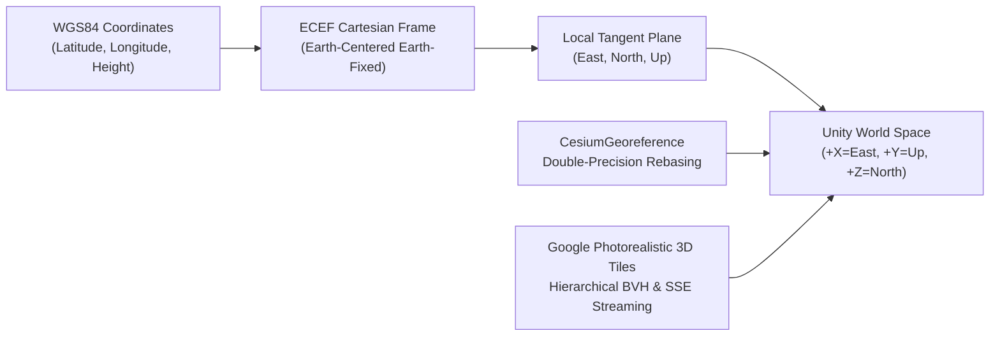
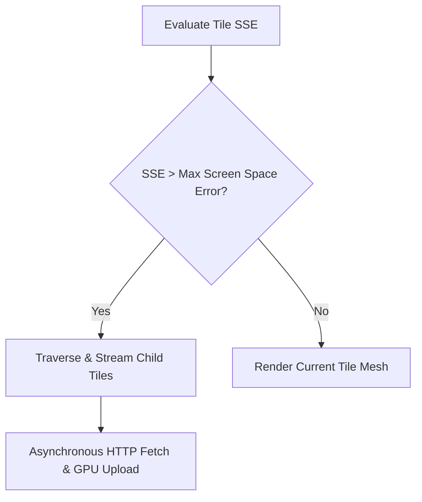
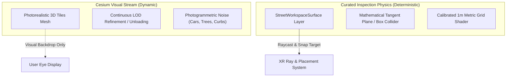

# Geospatial integration & 3D Tiles

The BIO-INTEL-MOB Geospatial Subsystem supplies the digital city models used by proposals, inspection workspaces, and traffic simulations.

Cesium for Unity streams high-fidelity, georeferenced urban models from Google Photorealistic 3D Tiles into the Unity runtime.

## Coordinate systems & georeferencing

Geospatial data and VR game engines use different spatial models:

### 1. WGS84 ellipsoidal coordinates

Geographic coordinates are defined by the World Geodetic System 1984 (WGS84):

- Latitude ($\phi$): Angular distance north or south of the Equator $[-90^\circ, +90^\circ]$.

- Longitude ($\lambda$): Angular distance east or west of the Prime Meridian $[-180^\circ, +180^\circ]$.

- Ellipsoidal Height ($h$): Distance in meters measured along the ellipsoidal normal above or below the WGS84 reference ellipsoid.

### 2. Earth-centered Earth-fixed (ECEF)

Before mapping onto a flat Cartesian plane, the runtime converts spherical/ellipsoidal coordinates to 3D Cartesian coordinates $(X, Y, Z)_{\text{ECEF}}$ relative to the Earth's center of mass:
$$X = (N(\phi) + h)\cos\phi\cos\lambda$$
$$Y = (N(\phi) + h)\cos\phi\sin\lambda$$
$$Z = \left(N(\phi)(1 - e^2) + h\right)\sin\phi$$
where $N(\phi) = \frac{a}{\sqrt{1 - e^2\sin^2\phi}}$ is the prime vertical radius of curvature, $a$ is the semi-major axis ($6\,378\,137.0\,\text{m}$), and $e$ is the first eccentricity.

### 3. Local tangent plane (ENU to Unity world space)

To avoid floating-point distortion when rendering city geometry, the runtime establishes a Local Tangent Plane (LTP) centered on a local pilot reference origin $(\phi_0, \lambda_0, h_0)$:

- East ($\Delta E$): Aligned with the local parallel pointing east.

- North ($\Delta N$): Aligned with the local meridian pointing true north.

- Up ($\Delta U$): Aligned with the local ellipsoidal surface normal.

In Unity's left-handed coordinate system ($+X = \text{Right}, +Y = \text{Up}, +Z = \text{Forward}$), the Local Tangent Plane is mapped directly as:
$$\vec{P}_{\text{unity}} = \begin{bmatrix} X_{\text{unity}} \\ Y_{\text{unity}} \\ Z_{\text{unity}} \end{bmatrix} = \begin{bmatrix} \Delta E \\ \Delta U \\ \Delta N \end{bmatrix}$$

### 4. High-precision rebasing via `CesiumGeoreference`

Unity uses single-precision 32-bit floating-point numbers (`float`), which provide approximately 7 decimal digits of precision. Coordinates relative to the Earth's center are on the order of $6.3 \times 10^6\,\text{m}$, which degrades 32-bit precision to $\approx 1\,\text{m}$, causing visible geometric shaking (jitter) in VR.

`CesiumGeoreference` maintains the origin in double-precision 64-bit coordinates (`double3`) and rebases Unity's world coordinate $(0, 0, 0)$ to the center of the active pilot site. This provides sub-millimeter positional precision for local urban assets.

## Google Photorealistic 3D Tiles

The platform streams city geometry using the OGC 3D Tiles specification and accesses Google's Photorealistic 3D Tiles catalog through Cesium ion.

### Hierarchical bounding volume tree (BVH)

3D Tiles organize multi-resolution spatial data into hierarchical trees. Each node is bounded by:

- Oriented Bounding Boxes (OBB): Tight bounding volumes oriented along local street directions.

- Bounding Spheres: Fast spatial culling for visibility testing.

- Bounding Regions: Defined by geographic latitudes, longitudes, and minimum/maximum altitudes.

### Level of detail & screen space error (SSE)

Screen Space Error (SSE) controls tile streaming. It measures the difference, in pixels, between simplified tile geometry and the real-world surface projected onto the VR display:

$$\text{SSE} = \frac{\delta \cdot H_{\text{viewport}}}{2 \cdot d \cdot \tan\left(\frac{\text{FOV}}{2}\right)}$$

where:

- $\delta$ is the tile's intrinsic Geometric Error (in meters).

- $H_{\text{viewport}}$ is the display height (in pixels).

- $d$ is the Euclidean distance from the camera to the tile's bounding volume.

- $\text{FOV}$ is the camera field of view angle.

- If $\text{SSE} > \tau_{\text{max}}$ (typically $\tau_{\text{max}} = 16\,\text{pixels}$ in VR): the tile is too coarse, so Cesium traverses the tree and streams higher-resolution child tiles.

- If $\text{SSE} \le \tau_{\text{max}}$: the current tile mesh meets the visual fidelity threshold and is rendered.

## Decoupling visual mesh streaming from physical interaction

BIO-INTEL-MOB keeps visual 3D Tiles separate from physical collision surfaces:

### Why 3D Tiles cannot serve directly as physics surfaces

1. Asynchronous Mesh Availability: 3D tiles stream asynchronously over HTTP. Teleportation and placement raycasts can miss the surface if a tile has not finished decoding.
2. LOD Geometric Discrepancies: As the user moves, tiles switch between coarser and finer LODs. Mesh vertices shift vertically by up to $0.5\,\text{m}$ to $2\,\text{m}$, which would cause placed furniture to float or sink into the ground.
3. Photogrammetric Surface Artifacts: Photogrammetry blends moving vehicles, road signs, curbs, and shadows into irregular, bumpy polygonal meshes. This rough geometry destabilizes walking physics and prevents precise furniture alignment.

### Production solution: curated workspace surfaces

When the user lands at a proposal, the `InspectionManager` samples the local ground height and creates a planar reference collider on the dedicated `StreetWorkspaceSurface` layer.

The 3D Tiles remain the visual backdrop. VR teleportation, controller raycasting, and furniture snapping use the stable workspace collider.
