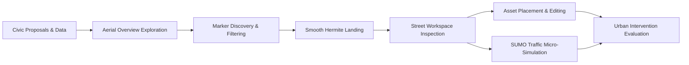
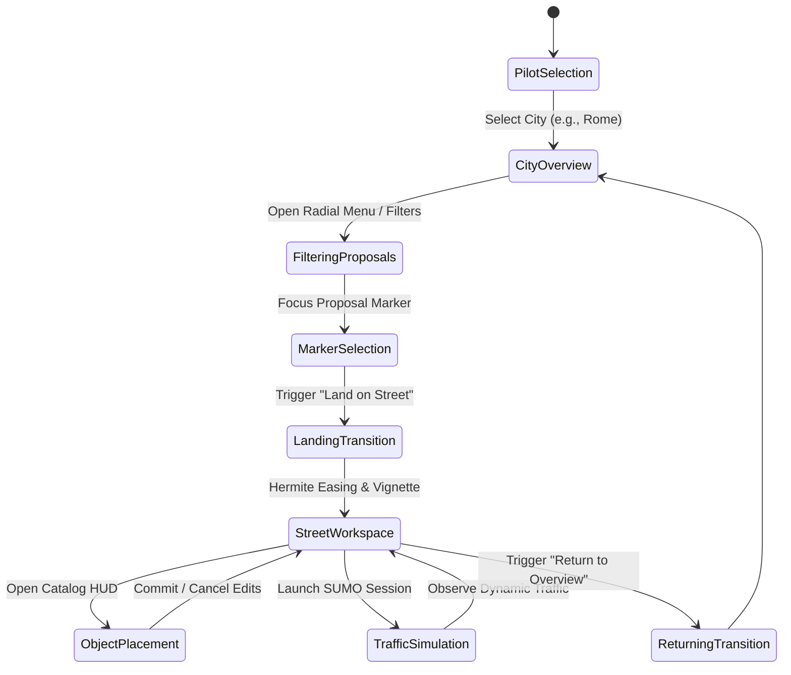

# Introduction

The BIO-INTEL-MOB Virtual Reality Platform is an immersive digital twin and civic crowdsourcing environment for evaluating urban mobility challenges, planning with citizens, and simulating spatial interventions.

Georeferenced city-scale 3D tiles provide the setting for street-level editing and microscopic traffic modeling. Citizens and planners can use these tools to test urban designs and assess their effects together.

## The crowdsourcing paradigm

Two-dimensional maps, static surveys, and public meetings can make spatial impacts difficult for non-experts to assess. BIO-INTEL-MOB supports civic participation through an interactive VR environment:

1. Spatial Grounding: Citizen proposals collected through municipal platforms appear at their real-world locations within photorealistic 3D city models.
2. Dual-Scale Spatial Exploration:
   - Macro-Scale (City Overview): A free-flying aerial drone perspective lets planners and citizens assess geographic distribution, density, and regional mobility patterns across pilot cities such as Rome and Cascais.
   - Micro-Scale (Street Workspace): A bounded physical environment is generated around a proposal. Users land at pedestrian eye level ($y \approx 1.7\,\text{m}$) to evaluate sidewalks, crossings, sightlines, and street geometry.
3. Participatory Intervention Design: Users can test potential mitigations, including bike lanes, traffic calming bollards, speed humps, and green buffers, through an ergonomic world-space asset placement catalog.
4. Dynamic Feedback Loop: Street modifications can be linked directly to microscopic traffic simulations (SUMO) for real-time visual feedback on congestion, queuing, and pedestrian accessibility.

## Core system goals

The architecture supports the following goals:

<CardGroup cols={2}>
  <Card title="Multi-Scale Immersion" icon="vr-cardboard">
    Move from high-altitude city exploration to detailed pedestrian street inspection without visual disorientation or scene reload overhead.
  </Card>
  <Card title="Real-Time Geospatial Grounding" icon="earth-americas">
    Align real-world WGS84 coordinates with Unity Cartesian coordinates using high-precision ellipsoidal georeferencing and 3D tile streaming.
  </Card>
  <Card title="Ergonomic VR Co-Design" icon="hand">
    Support VR interaction through procedural annular radial menus, contextual floating HUDs, metric placement grids, and dynamic outline feedback.
  </Card>
  <Card title="Microscopic Simulation Coupling" icon="traffic-light">
    Communicate asynchronously with SUMO through a dedicated multithreaded UDP pipeline and zero-allocation entity pooling for 90 FPS VR performance.
  </Card>
</CardGroup>

## End-to-end user journey

A session follows these stages:

1. Pilot Site Selection: The user selects an active municipal pilot, such as Rome. The system configures the geospatial datum and queries that pilot's WordPress REST endpoint.
2. Macro Exploration & Filtering: Users fly across the city with two-hand drone controls. Proposals appear as color-coded vertical beacons. The procedural radial menu and filter panel let users filter markers by category (*Transport*, *Environment*, *Infrastructure*, *Accessibility*), severity (*Low*, *Medium*, *High*), and resolution status.
3. Hermite Landing Transition: Selecting a proposal opens its metadata card. Triggering *Land on Street* starts a kinematic descent using S-curve Hermite interpolation and a dynamic tunneling vignette for motion sickness mitigation.
4. Street Workspace Activation: The system creates a local `StreetWorkspace` container with a metric reference grid, dedicated physics layers, and spatial boundary clamping ($r \le R_{\text{max}}$).
5. Interactive Co-Design & Placement: Users select street furniture from a data-driven catalog (`PlaceableDefinition`). They preview ghost meshes along controller rays, snap objects to the metric grid, and adjust rotation and uniform scale through the floating Workspace HUD.
6. Traffic Simulation Evaluation: Users can launch a local SUMO micro-simulation and stream vehicle and pedestrian trajectories in real time to observe responses to their interventions.
7. Return to Aerial Overview: Ending the inspection removes the temporary workspace and eases the camera back to aerial altitude, restoring city navigation.

## Documentation principles

Development and research teams follow these documentation principles:

- State Verification: Architectural descriptions distinguish implemented and verified production code from prototypes and roadmap proposals.

- Separation of Layers: Document UI abstractions, geospatial coordinate engines, physics layers, and backend transport contracts separately.

- Mathematical Formulations: Provide exact mathematical formulas for key algorithms, including coordinate projections, Hermite transition curves, Screen Space Error thresholds, and UDP byte parsing.

- VR Comfort First: Analyze each spatial transition and interaction mechanism against physiological sensory conflict principles and VR ergonomic standards.
