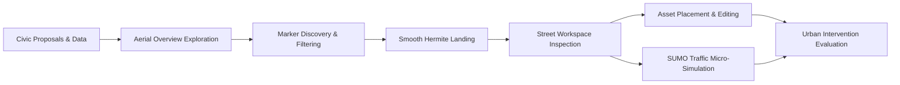
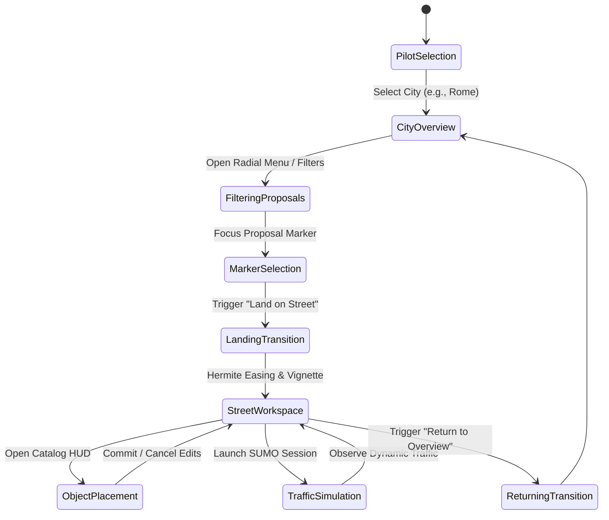

# Introduction

The **BIO-INTEL-MOB Virtual Reality Platform** is an immersive digital twin and civic crowdsourcing environment designed to evaluate urban mobility challenges, facilitate participatory planning, and simulate spatial interventions. 

By integrating georeferenced city-scale 3D tiles with microscopic traffic modeling and street-level spatial editing, the platform bridges the gap between passive citizen consultation and active, evidence-based urban co-design.

---

## The Crowdsourcing Paradigm

Traditional civic participation often relies on two-dimensional maps, static surveys, and public meetings where spatial impacts are difficult for non-experts to assess. BIO-INTEL-MOB shifts this paradigm into an **interactive virtual reality environment**:

1. **Spatial Grounding**: Real-world citizen proposals collected via municipal platforms are contextualized within photorealistic 3D city models rather than abstract tabular datasets.
2. **Dual-Scale Spatial Exploration**:
   - **Macro-Scale (City Overview)**: A free-flying aerial drone perspective allows urban planners and citizens to evaluate geographic distribution, density, and regional mobility patterns across entire pilot cities (e.g., Rome, Antwerp).
   - **Micro-Scale (Street Workspace)**: A bounded, localized physical environment generated around a proposal where users land at true pedestrian eye-level ($y \approx 1.7\,\text{m}$) to evaluate sidewalks, crossings, sightlines, and street geometry.
3. **Participatory Intervention Design**: Users do not merely review existing issues; they can test potential mitigations—such as bike lanes, traffic calming bollards, speed humps, and green buffers—using an ergonomic world-space asset placement catalog.
4. **Dynamic Feedback Loop**: Street modifications can be directly linked to microscopic traffic simulations (SUMO), providing real-time visual feedback on vehicle congestion, queuing, and pedestrian accessibility.

---

## Core System Goals

The engineering architecture of BIO-INTEL-MOB is oriented around five primary goals:

<CardGroup cols={2}>
  <Card title="Multi-Scale Immersion" icon="vr-cardboard">
    Seamless transition from high-altitude orbital city exploration down to fine-grained pedestrian street inspections without visual disorientation or scene reload overhead.
  </Card>
  <Card title="Real-Time Geospatial Grounding" icon="earth-americas">
    Accurate alignment of real-world WGS84 geographic coordinates with Unity Cartesian coordinates using high-precision ellipsoidal georeferencing and 3D tile streaming.
  </Card>
  <Card title="Ergonomic VR Co-Design" icon="hand">
    A comprehensive suite of VR-first input mechanisms: procedural annular radial menus, contextual floating HUDs, metric placement grids, and dynamic outline feedback.
  </Card>
  <Card title="Microscopic Simulation Coupling" icon="traffic-light">
    Asynchronous inter-process communication with SUMO via a dedicated multithreaded UDP pipeline and zero-allocation entity pooling for 90 FPS VR performance.
  </Card>
</CardGroup>

---

## End-to-End User Journey

The operational workflow within the platform is structured into well-defined sequential stages:

1. **Pilot Site Selection**: The user selects an active municipal pilot (e.g., Rome). The system configures the geospatial datum and queries the pilot's WordPress REST endpoint.
2. **Macro Exploration & Filtering**: Users fly across the city using two-hand drone controls. Proposals are rendered as color-coded vertical beacon markers. Using the procedural radial menu and filter panel, users filter markers by category (*Transport*, *Environment*, *Infrastructure*, *Accessibility*), severity (*Low*, *Medium*, *High*), and resolution status.
3. **Hermite Landing Transition**: Selecting a proposal opens its metadata card. Triggering *Land on Street* initiates a kinematic descent powered by an S-curve Hermite interpolation curve paired with a dynamic tunneling vignette to eliminate motion sickness.
4. **Street Workspace Activation**: The system constructs a localized `StreetWorkspace` container with a metric reference grid, dedicated physics layers, and spatial boundary clamping ($r \le R_{\text{max}}$).
5. **Interactive Co-Design & Placement**: Users select street furniture from a data-driven catalog (`PlaceableDefinition`), previewing ghost meshes along controller rays, snapping to the metric grid, and adjusting rotation and uniform scale via the floating Workspace HUD.
6. **Traffic Simulation Evaluation**: Users can launch a localized SUMO micro-simulation, streaming real-time vehicle and pedestrian trajectories to observe dynamic responses to the urban interventions.
7. **Return to Aerial Overview**: Concluding the inspection gracefully dismantles the temporary workspace and eases the user camera back to aerial altitude, restoring macro-navigation.

---

## Documentation Principles

To maintain rigorous technical integrity across all development and research teams:

- **State Verification**: Architectural descriptions explicitly distinguish between **implemented and verified production code**, **prototypes**, and **forward-looking roadmap proposals**.
- **Separation of Layers**: UI abstractions, geospatial coordinate engines, physics layers, and backend transport contracts are strictly isolated in documentation.
- **Mathematical Formulations**: Key algorithms—such as coordinate projections, Hermite transition curves, Screen Space Error thresholds, and UDP byte parsing—are provided with exact mathematical formulas.
- **VR Comfort First**: Every spatial transition and interaction mechanism is analyzed against physiological sensory conflict principles to ensure compliance with VR ergonomic standards.
