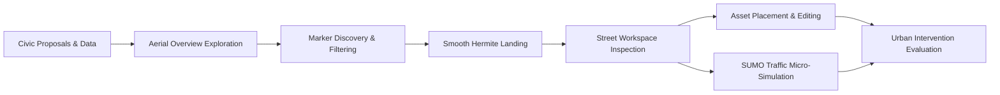

# BIO-INTEL-MOB documentation portal

The BIO-INTEL-MOB Virtual Reality Platform is an immersive digital twin and civic crowdsourcing environment for participatory urban mobility planning.

Users can explore georeferenced city models, review geolocated citizen proposals, and inspect streets in local workspaces. Asset placement tools support collaborative design, and microscopic traffic and pedestrian simulations help users evaluate interventions within the same runtime.

## Explore the documentation

<CardGroup cols={2}>
  <Card title="System Architecture" icon="network-wired" href="/architecture/system-overview">
    Architecture reference image, project workflow diagram, runtime subsystems, and service sequences.
  </Card>
  <Card title="Unity VR & Ergonomics" icon="vr-cardboard" href="/unity-vr/overview">
    OpenXR integration, sensory conflict theory, dynamic tunneling vignette, and procedural radial UI.
  </Card>
  <Card title="Geospatial & 3D Tiles" icon="earth-americas" href="/geospatial/cesium">
    WGS84 ellipsoidal transformations, CesiumGeoreference double-precision rebasing, SSE metrics, and physics decoupling.
  </Card>
  <Card title="Street Inspection Workspace" icon="map-pin" href="/inspection/street-inspection">
    Hermite landing kinematics, workspace hierarchy, metric grids, and asset placement lifecycle.
  </Card>
  <Card title="SUMO Traffic Simulation" icon="traffic-light" href="/simulation/sumo">
    Multithreaded UDP socket streaming, coordinate conversion formulas, and zero-allocation object pooling.
  </Card>
  <Card title="WordPress Backend & REST API" icon="server" href="/backend/wordpress">
    Pilot-specific REST architecture, proposal taxonomy, marker lifecycle, and intervention persistence.
  </Card>
</CardGroup>

## Repositories & resources

- Unity VR Application: [ctlup/CrowdSourcing_Virtual-Reality](https://github.com/ctlup/CrowdSourcing_Virtual-Reality)

- Documentation Repository: [ctlup/BIO-INTEL-MOB-Docs](https://github.com/ctlup/BIO-INTEL-MOB-Docs)

- Interactive OpenAPI Explorer: [API Reference](/api-reference/overview)
