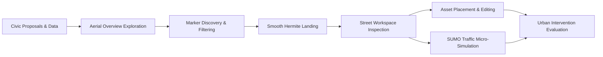

# BIO-INTEL-MOB Documentation Portal

Welcome to the technical documentation and architectural reference for the **BIO-INTEL-MOB Virtual Reality Platform**—an immersive digital twin and civic crowdsourcing environment for participatory urban mobility planning.

The platform combines city-scale geospatial visualization, geolocated citizen proposals, street-level inspection workspaces, ergonomic asset co-design, and microscopic traffic/pedestrian simulation into a unified runtime stack.

---

## Explore the Documentation

<CardGroup cols={2}>
  <Card title="System Architecture" icon="network-wired" href="/architecture/system-overview">
    Single-scene runtime topology, subsystem boundaries, service managers, and sequence diagrams.
  </Card>
  <Card title="Unity VR & Ergonomics" icon="vr-cardboard" href="/unity-vr/overview">
    OpenXR integration, sensory conflict theory, dynamic tunneling vignette, and procedural radial UI.
  </Card>
  <Card title="Geospatial & 3D Tiles" icon="earth-americas" href="/geospatial/cesium">
    WGS84 ellipsoidal transformations, CesiumGeoreference double-precision rebasing, SSE metrics, and physics decoupling.
  </Card>
  <Card title="Street Inspection Workspace" icon="map-pin" href="/inspection/street-inspection">
    Hermite landing kinematics, workspace hierarchy, metric grids, and asset placement lifecycle.
  </Card>
  <Card title="SUMO Traffic Simulation" icon="traffic-light" href="/simulation/sumo">
    Multithreaded UDP socket streaming, coordinate conversion formulas, and zero-allocation object pooling.
  </Card>
  <Card title="WordPress Backend & REST API" icon="server" href="/backend/wordpress">
    Pilot-specific REST architecture, proposal taxonomy, marker lifecycle, and intervention persistence.
  </Card>
</CardGroup>

---

## Repositories & Resources

- **Unity VR Application**: [khadeer0503/CrowdSourcing_Virtual-Reality](https://github.com/khadeer0503/CrowdSourcing_Virtual-Reality)
- **Documentation Repository**: [khadeer0503/BIO-INTEL-MOB-Docs](https://github.com/khadeer0503/BIO-INTEL-MOB-Docs)
- **Interactive OpenAPI Explorer**: [API Reference](/api-reference/overview)
