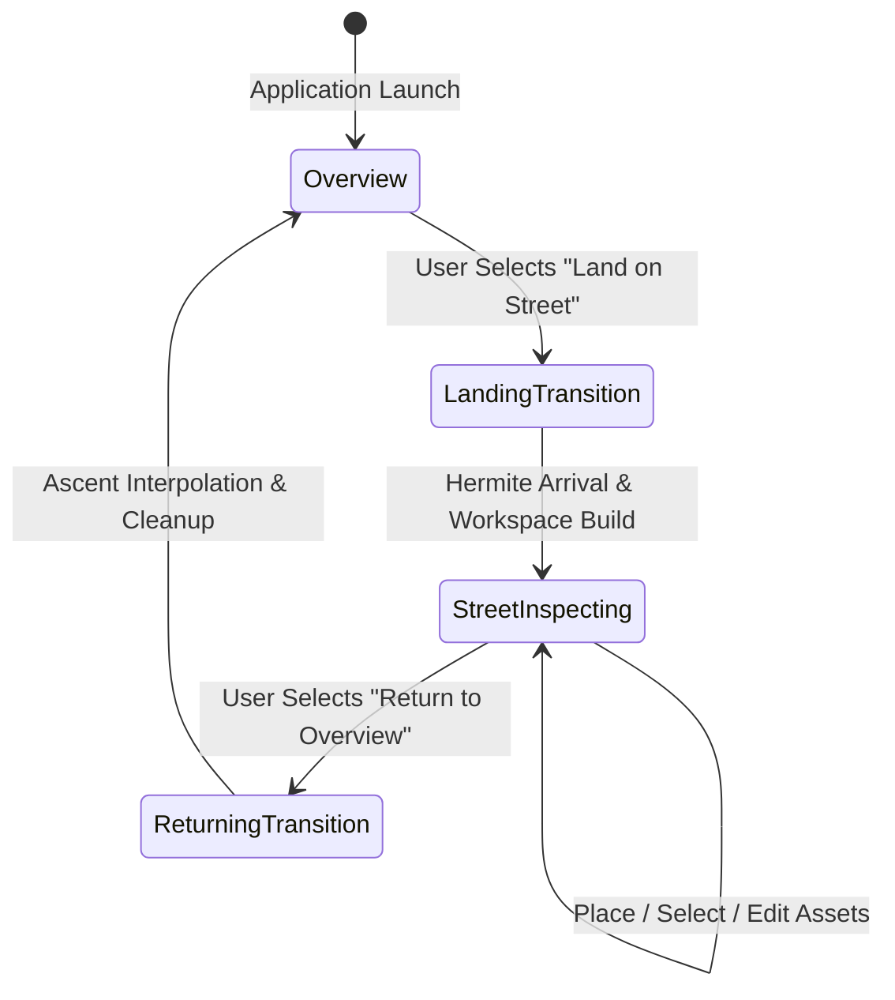
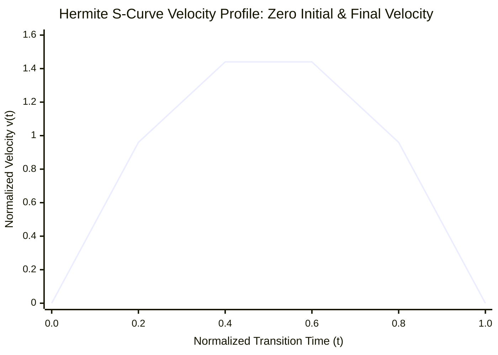
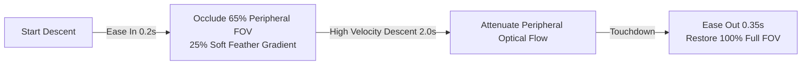
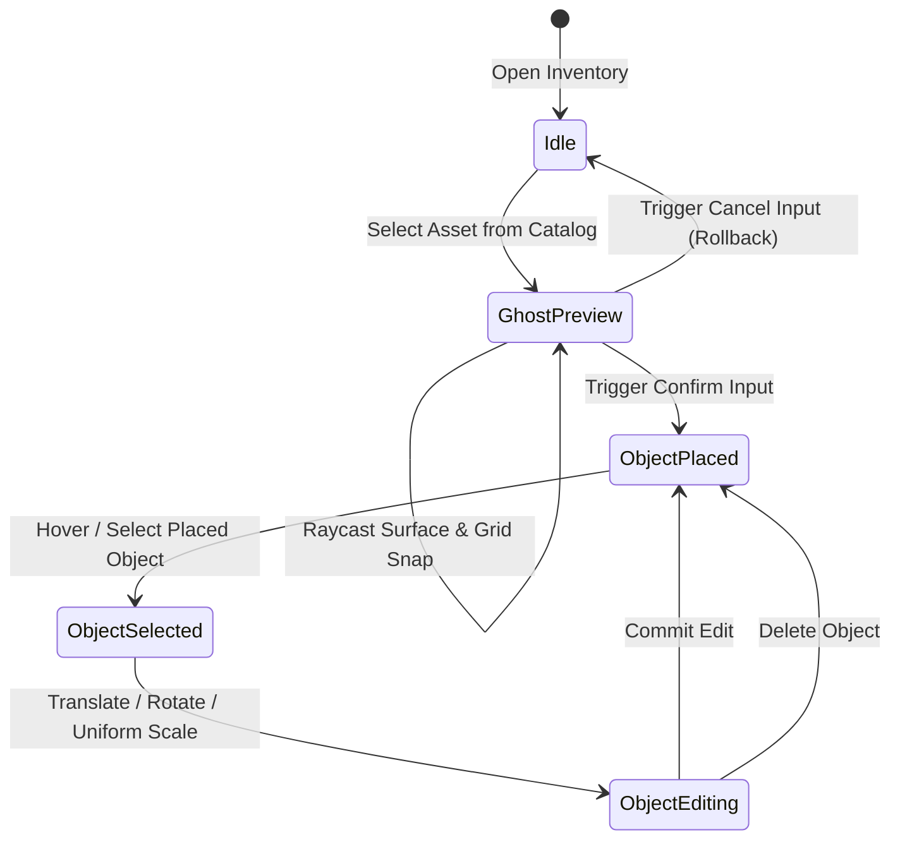

# Street inspection & co-design workspace

The Street Inspection System takes users from high-altitude city exploration to a bounded pedestrian workspace centered on a civic proposal.

In the workspace, planners and citizens can assess pedestrian sightlines and inspect street conditions. A data-driven 3D asset catalog lets them place and edit objects to test urban design interventions.



## Landing workflow & S-curve Hermite interpolation

Moving the camera from an aerial altitude (e.g., $150\,\text{m}$) down to street level ($1.7\,\text{m}$) can cause motion sickness in continuous VR if movement starts or stops abruptly.

### 1. Landing target calculation

When a proposal is selected, the `LandingController` computes a safe pedestrian landing pose $(\vec{P}_{\text{target}}, \mathbf{q}_{\text{target}})$:

- Pedestrian Eye-Level Offset: The target position is elevated by the standard human eye height ($h_{\text{eye}} = 1.7\,\text{m}$) along the local geodetic up normal $\vec{U}_{\text{local}}$:
  $$\vec{P}_{\text{target}} = \vec{P}_{\text{proposal}} + \vec{D}_{\text{standoff}} + h_{\text{eye}}\vec{U}_{\text{local}}$$

- Sightline Tangent: The camera rotation $\mathbf{q}_{\text{target}}$ faces horizontally toward the proposal anchor so the user lands facing the issue being inspected.

### 2. Cubic Hermite interpolation formula

The camera translation uses normalized cubic Hermite S-curve interpolation to start and end at zero velocity:

$$s(t) = 3t^2 - 2t^3, \quad t \in [0, 1]$$

$$\vec{P}(t) = \vec{P}_{\text{start}} + s(t) \cdot (\vec{P}_{\text{target}} - \vec{P}_{\text{start}})$$

$$\mathbf{q}(t) = \text{Slerp}(\mathbf{q}_{\text{start}}, \mathbf{q}_{\text{target}}, s(t))$$



The velocity derivative $\frac{ds}{dt} = 6t(1 - t)$ satisfies $\left.\frac{ds}{dt}\right|_{t=0} = 0$ and $\left.\frac{ds}{dt}\right|_{t=1} = 0$, so the camera departs and arrives at rest. This cubic curve does not make endpoint acceleration zero; it smooths the velocity transition.

## Motion sickness mitigation: dynamic tunneling vignette

During the $2.5\,\text{s}$ descent, the `TunnelingVignetteController` reduces peripheral visual vection:



1. Ease-In ($0.2\,\text{s}$): As velocity begins ramping up, a circular black vignette smoothly constricts the visual field, occluding the outer $65\%$ of the display with a softened $25\%$ gradient feather.
2. Peripheral Masking: The mask blocks motion cues in the peripheral retina, which is highly sensitive to optical motion, while leaving central foveal vision clear.
3. Ease-Out ($0.35\,\text{s}$): As the camera settles at $\vec{P}_{\text{target}}$, the aperture expands smoothly to restore the full street view.

## Locomotion mode reconfiguration

On touchdown, the `StreetModeController` changes the locomotion settings:

- Drone Flight Disabled: Continuous flight controls are disabled to prevent accidental upward movement.

- Bounded Walking Activated: Continuous walking is clamped to a calibrated pedestrian speed ($1.2\,\text{m/s}$).

- Teleportation Gated: Parabolic teleportation rays are restricted to collision surfaces inside the workspace boundary ($r \le R_{\text{max}}$).

- Snap Turning: Maintained at discrete $45^\circ$ increments.

## Street workspace production hierarchy

The workspace is built at runtime under a dedicated root GameObject:

```text
StreetWorkspace_<proposalId>
├── Anchor
├── Reference
│   └── GIS
│       ├── Roads
│       ├── Sidewalks
│       ├── Crossings
│       └── Terrain
├── Interaction
│   └── PlacementSurfaces
│       ├── ReferenceSurface (Physics Collider on StreetWorkspaceSurface)
│       ├── InspectionGrid (1m / 0.2m Metric Shader Grid)
│       ├── Colliders
│       └── SnapPoints
├── Visualization (Boundary Ring, Measurement Overlays)
├── EditableObjects (Placed PlaceableObject Instances)
└── Runtime (Transient SUMO Vehicles & Pedestrians)
```

### Hierarchy responsibilities

- `Anchor`: Defines the geodetic anchor aligned with the proposal's WGS84 coordinates.

- `Interaction / PlacementSurfaces`: Contains the physical placement collider and metric grid.

- `Dedicated Physics Layer (StreetWorkspaceSurface)`: All placement raycasts and teleportation checks use this layer exclusively, keeping placement physics separate from streamed Cesium 3D Tiles.

- `EditableObjects`: Parents all user-placed assets. Destroying this container when the user exits or cancels inspection unloads the placed objects without leaving orphaned objects or memory leaks.

## Metric placement grid & boundary clamping

The workspace surface uses a procedural Metric Grid Shader to support precise urban layouts:

- Primary Grid Lines: High-contrast major axis lines at $1.0\,\text{m}$ intervals.

- Sub-Tick Intervals: Subdivisions at $0.2\,\text{m}$ ($20\,\text{cm}$) intervals for aligning curbs and furniture.

- Spatial Boundary Enforcement: Placed assets are restricted to a defined radius $R_{\text{max}}$ (typically $50\,\text{m}$) from the workspace anchor:
  $$r = \sqrt{x_{\text{local}}^2 + z_{\text{local}}^2} \le R_{\text{max}}$$
  When a controller ray points beyond $R_{\text{max}}$, placement preview turns red and input confirmation is blocked.

## Asset inventory & placement lifecycle

Users can populate the workspace with configurable urban furniture, including benches, bollards, bike racks, planter boxes, bus shelters, and warning signs:



### 1. Data-driven catalog (`PlaceableDefinition`)

ScriptableObjects define each asset:

- Metadata: Unique ID, category (*Furniture*, *Safety*, *Greenery*, *Transit*), localized title, and icon.

- Prefab Reference: 3D visual model and LOD group.

- Physical Extents: Bounding box dimensions for collision footprint and grid snapping.

- Placement Constraints: Ground alignment flags and allowable rotation axes.

### 2. Dynamic collider synthesis

Models imported from CAD or photogrammetry sources often lack Unity physics colliders.

When an asset is instantiated, `PlaceableObjectInteraction` checks its mesh hierarchy. If the asset has no colliders, it computes the combined mesh bounds and creates an oriented BoxCollider or Compound BoxCollider. The object can then receive XR Ray selection and manipulation immediately.

### 3. Two-phase placement & transactional rollback

1. Phase 1: Placing New Assets:
   - Selecting an item from the inventory spawns a translucent "ghost" instance following the controller raycast hit point on the `StreetWorkspaceSurface`.
   - Pressing Confirm instantiates the permanent `PlaceableObject` and equips it with selection handles.
   - Pressing Cancel immediately destroys the ghost preview and restores the workspace state without memory leaks.
2. Phase 2: Persistent Object Selection & Editing:
   - Selecting a placed object highlights it with a luminous outline shader and opens the Floating Workspace HUD.
   - Users can translate the object along the surface plane, rotate it around its vertical axis, or adjust uniform scale.

## Floating workspace HUD

The Workspace HUD presents world-space editing controls within the user's field of view:

- Spatial Anchoring: Floats at eye height $\approx 1.2\,\text{m}$ in front of the user, tilted downward by $-15^\circ$ to prevent arm fatigue.

- Two-Tier Action Architecture:
  - Primary Controls: *Confirm*, *Cancel*, *Rotate Left/Right ($15^\circ$)*, *Scale Up/Down*.
  - Secondary Controls: *Delete Asset*, *Duplicate*, *Toggle Grid Snapping*, *Return to Overview*.

- Collapsible State: Collapses into a compact floating pill when no object is selected, keeping the street view clear during review.
