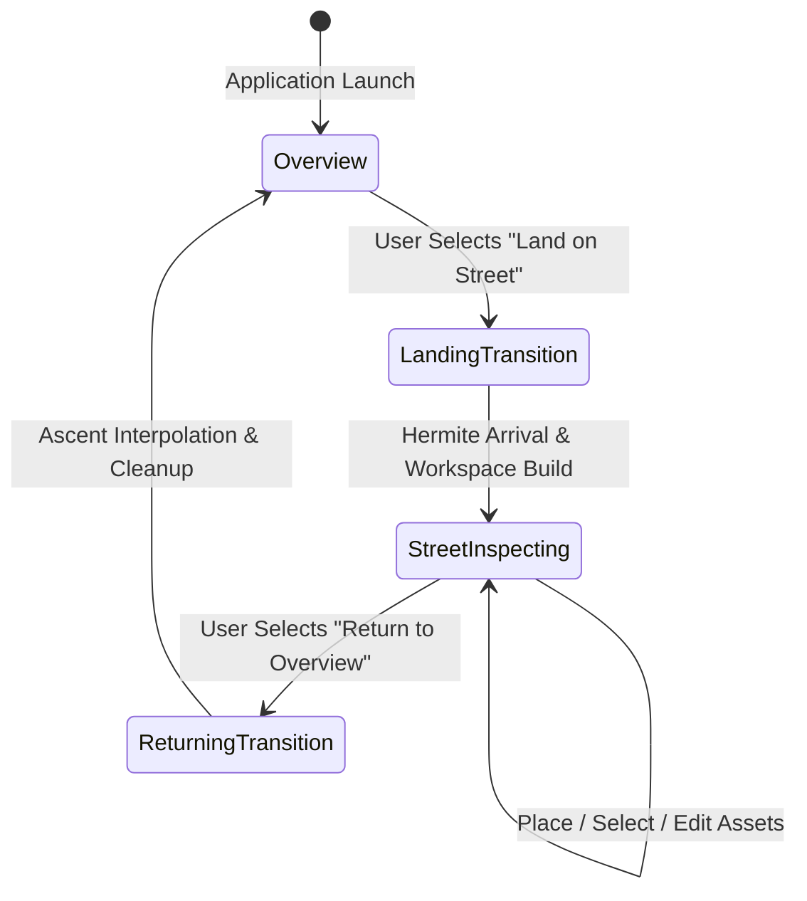
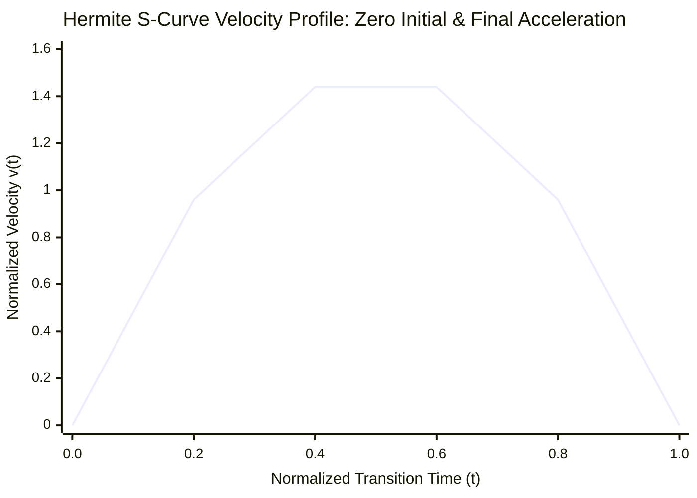
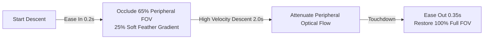
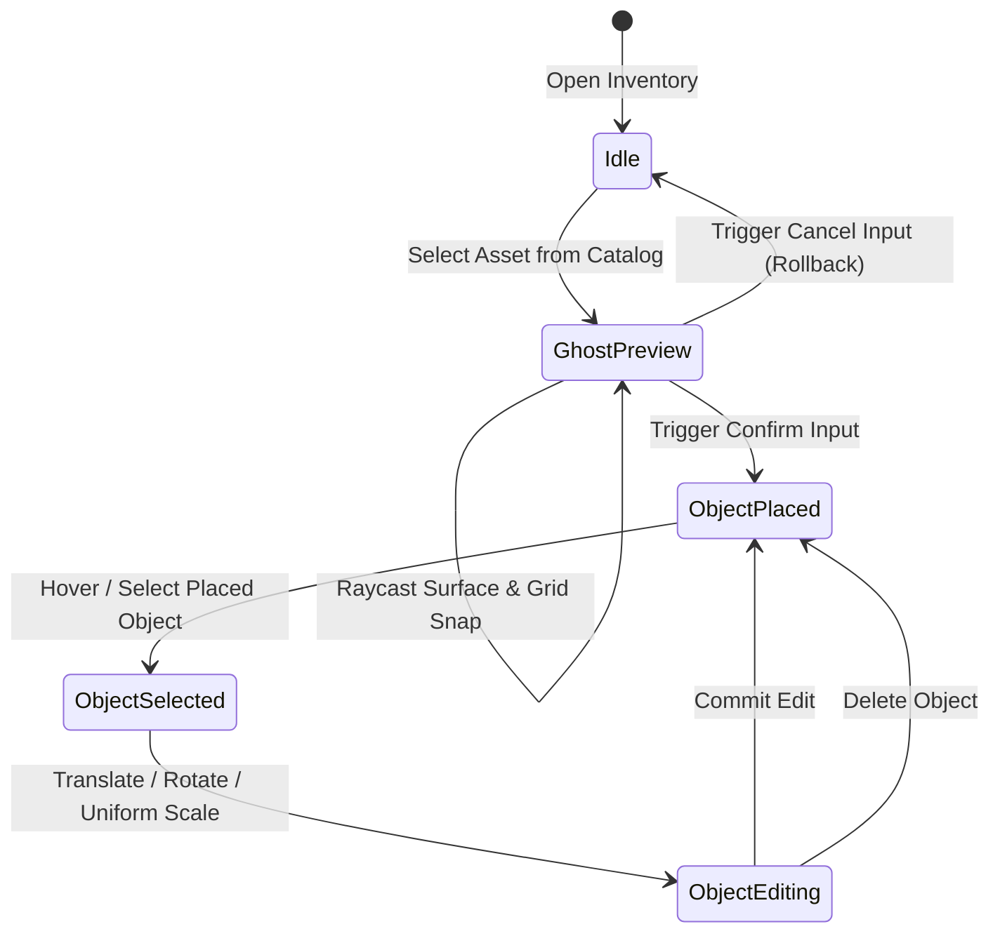

# Street Inspection & Co-Design Workspace

The **Street Inspection System** transitions the user from high-altitude macroscopic city exploration into a localized, bounded pedestrian workspace centered on a civic proposal. 

Within this workspace, urban planners and citizens can evaluate pedestrian sightlines, inspect street conditions, and test urban design interventions using a data-driven 3D asset placement and editing catalog.



---

## Landing Workflow & S-Curve Hermite Interpolation

Moving the user camera from an aerial altitude (e.g., $150\,\text{m}$) down to street level ($1.7\,\text{m}$) in continuous VR presents extreme risks of motion sickness if linear velocity abruptly starts or stops.

### 1. Landing Target Calculation
When a proposal is selected, the `LandingController` computes a safe pedestrian landing pose $(\vec{P}_{\text{target}}, \mathbf{q}_{\text{target}})$:
- **Pedestrian Eye-Level Offset**: The target position is elevated by the standard human eye height ($h_{\text{eye}} = 1.7\,\text{m}$) along the local geodetic up normal $\vec{U}_{\text{local}}$:
  $$\vec{P}_{\text{target}} = \vec{P}_{\text{proposal}} + \vec{D}_{\text{standoff}} + h_{\text{eye}}\vec{U}_{\text{local}}$$
- **Sightline Tangent**: The camera rotation $\mathbf{q}_{\text{target}}$ is oriented horizontally toward the proposal anchor point, ensuring the user lands directly facing the issue of interest.

### 2. Cubic Hermite Interpolation Formula
To eliminate kinematic jerk (rate of change of acceleration), the translation is evaluated using a normalized cubic **Hermite S-curve interpolation**:

$$s(t) = 3t^2 - 2t^3, \quad t \in [0, 1]$$

$$\vec{P}(t) = \vec{P}_{\text{start}} + s(t) \cdot (\vec{P}_{\text{target}} - \vec{P}_{\text{start}})$$

$$\mathbf{q}(t) = \text{Slerp}(\mathbf{q}_{\text{start}}, \mathbf{q}_{\text{target}}, s(t))$$



Because the velocity derivative $\frac{ds}{dt} = 6t(1 - t)$ satisfies $\left.\frac{ds}{dt}\right|_{t=0} = 0$ and $\left.\frac{ds}{dt}\right|_{t=1} = 0$, both initial departure and final arrival feature zero acceleration steps, providing an exceptionally smooth physical sensation.

---

## Motion Sickness Mitigation: Dynamic Tunneling Vignette

Throughout the $2.5\,\text{s}$ descent, the `TunnelingVignetteController` actively suppresses peripheral visual vection:



1. **Ease-In ($0.2\,\text{s}$)**: As velocity begins ramping up, a circular black vignette smoothly constricts the visual field, occluding the outer $65\%$ of the display with a softened $25\%$ gradient feather.
2. **Peripheral Masking**: The peripheral retina (which is intensely sensitive to optical motion cues) is blanked, while central foveal vision remains unimpeded.
3. **Ease-Out ($0.35\,\text{s}$)**: As the camera settles at $\vec{P}_{\text{target}}$, the aperture expands back to full view, smoothly unveiling the street environment.

---

## Locomotion Mode Reconfiguration

Upon touchdown, the `StreetModeController` transitions the user's locomotion stack:
- **Drone Flight Disabled**: Free continuous flying controls are disabled to prevent users from accidentally rocketing upward into the sky.
- **Bounded Walking Activated**: Continuous walking is clamped to a calibrated pedestrian speed ($1.2\,\text{m/s}$).
- **Teleportation Gated**: Parabolic teleportation rays are restricted to collision surfaces inside the workspace boundary ($r \le R_{\text{max}}$).
- **Snap Turning**: Maintained at discrete $45^\circ$ increments.

---

## Street Workspace Production Hierarchy

Rather than relying on static scene geometry, the workspace is **constructed programmatically at runtime** under a dedicated root GameObject:

```text
StreetWorkspace_<proposalId>
├── Anchor
├── Reference
│   └── GIS
│       ├── Roads
│       ├── Sidewalks
│       ├── Crossings
│       └── Terrain
├── Interaction
│   └── PlacementSurfaces
│       ├── ReferenceSurface (Physics Collider on StreetWorkspaceSurface)
│       ├── InspectionGrid (1m / 0.2m Metric Shader Grid)
│       ├── Colliders
│       └── SnapPoints
├── Visualization (Boundary Ring, Measurement Overlays)
├── EditableObjects (Placed PlaceableObject Instances)
└── Runtime (Transient SUMO Vehicles & Pedestrians)
```

### Hierarchy Responsibilities
- **`Anchor`**: Represents the geodetic anchor point aligned with the proposal's WGS84 coordinates.
- **`Interaction / PlacementSurfaces`**: Houses the physical placement collider and metric grid.
- **`Dedicated Physics Layer (StreetWorkspaceSurface)`**: All placement raycasts and teleportation checks mask exclusively against this layer. This isolates placement physics from streamed Cesium 3D Tiles.
- **`EditableObjects`**: Dynamic parent container for all user-placed assets. If the user exits or cancels the inspection, destroying this container unloads all placed objects without orphaned memory leaks.

---

## Metric Placement Grid & Boundary Clamping

To facilitate engineering-grade urban layout decisions, the workspace surface renders a procedural **Metric Grid Shader**:
- **Primary Grid Lines**: Major axis intervals at $1.0\,\text{m}$ intervals with high contrast.
- **Sub-Tick Intervals**: Subdivisions at $0.2\,\text{m}$ ($20\,\text{cm}$) intervals for aligning curbs and furniture.
- **Spatial Boundary Enforcement**: Placed assets are restricted to a defined radius $R_{\text{max}}$ (typically $50\,\text{m}$) from the workspace anchor:
  $$r = \sqrt{x_{\text{local}}^2 + z_{\text{local}}^2} \le R_{\text{max}}$$
  If a controller ray points beyond $R_{\text{max}}$, placement preview turns red and input confirmation is blocked.

---

## Asset Inventory & Placement Lifecycle

The placement system enables users to populate the workspace with configurable urban furniture (benches, bollards, bike racks, planter boxes, bus shelters, warning signs):



### 1. Data-Driven Catalog (`PlaceableDefinition`)
Assets are configured via ScriptableObjects:
- **Metadata**: Unique ID, category (*Furniture*, *Safety*, *Greenery*, *Transit*), localized title, and icon.
- **Prefab Reference**: 3D visual model and LOD group.
- **Physical Extents**: Bounding box dimensions for collision footprint and grid snapping.
- **Placement Constraints**: Ground alignment flags and allowable rotation axes.

### 2. Dynamic Collider Synthesis
Catalog models imported from external CAD or photogrammetry sources often lack Unity physics colliders. 

When an asset is instantiated, `PlaceableObjectInteraction` checks its mesh hierarchy. If colliders are absent, it dynamically computes the aggregate mesh bounding volume and synthesizes an oriented **BoxCollider** or **Compound BoxCollider**, ensuring the object can immediately receive XR Ray selection and manipulation.

### 3. Two-Phase Placement & Transactional Rollback
1. **Phase 1: Placing New Assets**:
   - Selecting an item from the inventory spawns a translucent "ghost" instance following the controller raycast hit point on the `StreetWorkspaceSurface`.
   - Pressing **Confirm** instantiates the permanent `PlaceableObject` and equips it with selection handles.
   - Pressing **Cancel** immediately destroys the ghost preview, restoring pristine workspace state without memory leaks.
2. **Phase 2: Persistent Object Selection & Editing**:
   - Selecting an existing placed object highlights it with a luminous selection outline shader and opens the **Floating Workspace HUD**.
   - Users can translate the object along the surface plane, rotate it around its vertical axis, or adjust uniform scale.

---

## Floating Workspace HUD

The **Workspace HUD** is a world-space control interface positioned ergonomically relative to the user's field of view:
- **Spatial Anchoring**: Floats at eye height $\approx 1.2\,\text{m}$ in front of the user, tilted downward by $-15^\circ$ to prevent arm fatigue.
- **Two-Tier Action Architecture**:
  - **Primary Controls**: *Confirm*, *Cancel*, *Rotate Left/Right ($15^\circ$)*, *Scale Up/Down*.
  - **Secondary Controls**: *Delete Asset*, *Duplicate*, *Toggle Grid Snapping*, *Return to Overview*.
- **Collapsible State**: Automatically collapses into a compact floating pill when no object is selected, preventing visual obstruction during spatial review.
