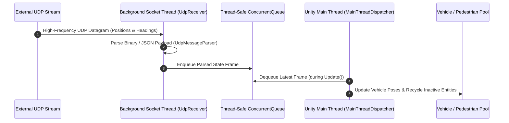
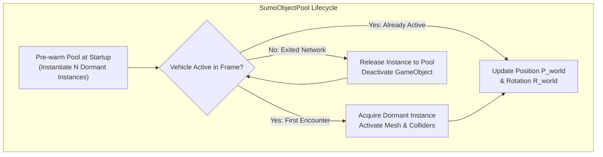

# SUMO Traffic Simulation Integration

The **Traffic Simulation System** bridges the BIO-INTEL-MOB virtual reality environment with **SUMO (Simulation of Urban MObility)**, an open-source microscopic traffic and pedestrian simulation suite. 

Rather than simulating simplified traffic behaviors inside Unity scripts, the platform leverages SUMO's validated microscopic physics models (car-following, lane-changing, intersection signal controllers, and pedestrian models) while streaming real-time vehicle and pedestrian trajectories into Unity for immersive VR evaluation.

```mermaid
flowchart LR
    subgraph SUMO_Process["External Simulation Process"]
        CFG["sumo.cfg / .net.xml"] --> SUMO_Core["SUMO Engine (Krauss / TraCI)"]
        SUMO_Core --> UDP_Pub["UDP Publisher Daemon"]
    end

    subgraph Unity_Runtime["Unity 6 VR Client"]
        UDP_Sub["UdpReceiver\n(Dedicated Background Thread)"] --> Parser["UdpMessageParser\n(Fast Byte/JSON Parsing)"]
        Parser --> Queue["Concurrent Queue\n(Thread-Safe Buffer)"]
        Queue --> MTD["MainThreadDispatcher\n(Update Loop Sync)"]
        MTD --> GeoConv["SumoGeoConverter\n(UTM -> WGS84 -> Unity)"]
        GeoConv --> Pool["SumoObjectPool\n(VehiclePool & PedestrianPool)"]
    end

    UDP_Pub -.->|UDP Datagrams (5005)| UDP_Sub
```

---

## Process Management: `SumoLauncher`

The execution of SUMO is managed through the `SumoLauncher` service component:
- **Headless Execution**: Invokes the `sumo` or `sumo-gui` binary as a detached subprocess with arguments specifying the target scenario directory:
  ```powershell
  sumo -c scenario.sumocfg --remote-port 1337 --step-length 0.1 --start
  ```
- **Scenario Artifacts**: Loads street network files (`.net.xml`), route flows (`.rou.xml`), and polygon shape definitions (`.poly.xml`) matching the active pilot inspection site.
- **Process Supervision**: Monitors process health, captures stdout/stderr streams, and guarantees graceful termination when the VR user exits inspection mode.

---

## Multithreaded Asynchronous Networking Pipeline

Unity operates on a single main thread for game logic and rendering. Performing synchronous socket reads or unmarshalling large JSON packets directly inside the render loop causes severe frame rate drops, dropping below the mandatory 90 FPS VR budget.

To maintain ultra-smooth VR rendering, the platform implements a **three-tier asynchronous pipeline**:



### 1. `UdpReceiver` (Dedicated Background Socket Thread)
- Runs continuously on a high-priority background worker thread.
- Binds to a local UDP socket (`UdpClient`), listening for incoming datagrams asynchronously.
- Operates completely decoupled from Unity's rendering framerate.

### 2. `UdpMessageParser`
- Parses incoming frame datagrams with minimal memory allocations.
- Extracts entity IDs, simulation coordinates $(x_{\text{sumo}}, y_{\text{sumo}})$, speed $v$, vehicle type, and heading angle $\theta_{\text{sumo}}$.

### 3. `MainThreadDispatcher`
- Stores parsed frame structures into a thread-safe `ConcurrentQueue<SimulationFrame>`.
- During Unity's `Update()` loop, the dispatcher dequeues only the latest available frame, discarding stale intermediate packets and safely passing the data to Unity scene objects.

---

## Geospatial Coordinate Transformation: `SumoGeoConverter`

SUMO uses a local 2D metric Cartesian coordinate system defined by the projected road network, whereas Unity positions entities within a georeferenced 3D space. 

The `SumoGeoConverter` executes a three-stage mathematical transformation pipeline:

```mermaid
flowchart LR
    S1["1. SUMO Cartesian\n(x_sumo, y_sumo)"] -->|UTM Inverse Projection| S2["2. WGS84 Geographic\n(Latitude φ, Longitude λ)"]
    S2 -->|CesiumGeoreference| S3["3. Unity World Position\n(X_unity, Y_unity, Z_unity)"]
    S4["4. SUMO Heading\nθ_sumo (Clockwise from North)"] -->|AngleAxis(θ, Up)| S5["5. Unity Orientation\nQuaternion R_world"]
```

### Mathematical Formulations

#### 1. Cartesian to WGS84 Geographic
Using the network's Universal Transverse Mercator (UTM) projection parameters $(\lambda_0, \phi_0, k_0, x_0, y_0)$ extracted from the `.net.xml` header:
$$(\phi, \lambda) = \mathcal{T}_{\text{UTM}}^{-1}(x_{\text{sumo}} - x_0, \, y_{\text{sumo}} - y_0)$$

#### 2. WGS84 to Unity World Space
The geographic coordinate pair $(\phi, \lambda)$ and local street surface elevation $h$ are passed into `CesiumGeoreference`:
$$\vec{P}_{\text{world}} = \text{CesiumGeoreference.TransformLongitudeLatitudeHeightToUnity}(\lambda, \phi, h)$$

#### 3. Vehicle Heading & Orientation
SUMO defines vehicle rotation angle $\theta_{\text{sumo}}$ in degrees clockwise from North ($0^\circ = \text{North}, 90^\circ = \text{East}$). 

In Unity's left-handed coordinate system (where $+Z$ is North and $+X$ is East), the 3D rotation quaternion $\mathbf{R}_{\text{world}}$ relative to the local ground normal $\vec{U}_{\text{local}}$ is:
$$\mathbf{R}_{\text{world}} = \text{Quaternion.AngleAxis}(\theta_{\text{sumo}}, \, \vec{U}_{\text{local}})$$

---

## High-Performance Object Pooling Architecture

In dense urban simulations, hundreds of vehicles and pedestrians continuously enter, traverse, and exit the street inspection area. 

Calling `GameObject.Instantiate()` and `GameObject.Destroy()` dynamically would trigger frequent garbage collection (GC) sweeps on the Mono/IL2CPP heap, causing noticeable hitching in the VR headset.



### Zero-Allocation Pool Mechanics
- **Pre-warmed Capacity**: `VehiclePool` and `PedestrianPool` pre-allocate pools of diverse vehicle categories (cars, vans, buses, bicycles) and animated pedestrian avatars.
- **Fast Lookup Table**: An active dictionary `Dictionary<string, PooledAgent>` tracks active vehicle IDs.
- **`Acquire(vehicleId, type)`**: When an ID first appears in the UDP frame, an inactive GameObject is taken from the pool queue, enabled, and assigned to the active table.
- **`Release(vehicleId)`**: When an ID disappears from incoming frames for more than $\Delta t_{\text{timeout}}$, its GameObject is deactivated and returned to the dormant queue.
- **Net Result**: Zero heap allocations per frame during active traffic simulation.

---

## Evaluating Urban Interventions via Simulation

The integration of SUMO enables real-time visual assessment of street modifications:
1. **Traffic Calming Interventions**: Placing speed humps or chicane bollards in the `StreetWorkspace` can be reflected in SUMO as reduced edge speeds or modified lane widths.
2. **Pedestrian Crossing Additions**: Adding crosswalk assets allows planners to trigger pedestrian demand in SUMO, observing vehicle stopping behavior and potential vehicle queue build-up.
3. **Evidence-Based Co-Design**: Citizens and city officials can observe dynamic simulation feedback before committing municipal infrastructure investments.
