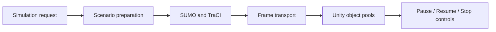

# Traffic and pedestrian simulation

SUMO is an external simulation dependency. Unity can request a simulation session, receive frame updates, and render corresponding vehicles/pedestrians.

## Conceptual lifecycle

## Runtime concerns

- Validate geographic-to-simulation coordinate conversion.
- Do not use a desktop-only local Python path for a deployed headset.
- Avoid direct unauthenticated remote UDP control; define trusted gateway/session handling as necessary.
- Bound update rates, packet sizes and object counts to maintain VR frame budgets.
- Treat traffic signal, speed limit and pedestrian interventions as simulation scenario inputs, not purely visual edits.

## Status

The project has a SUMO integration workflow, but end-to-end remote production deployment and intervention feedback should be verified against the current implementation.
