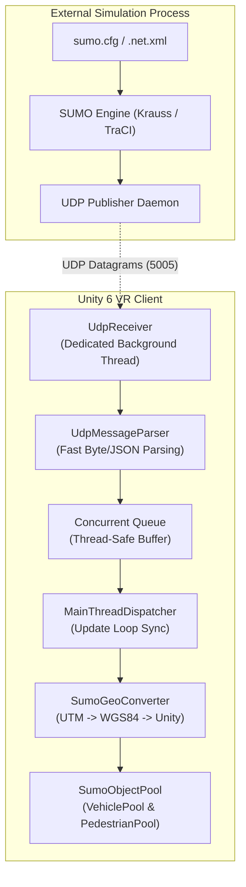
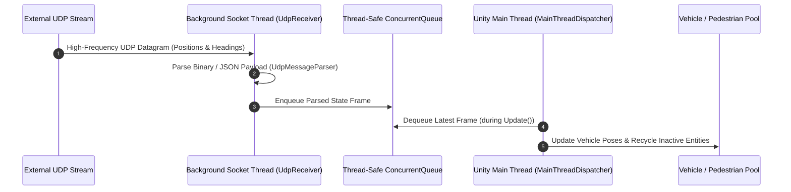
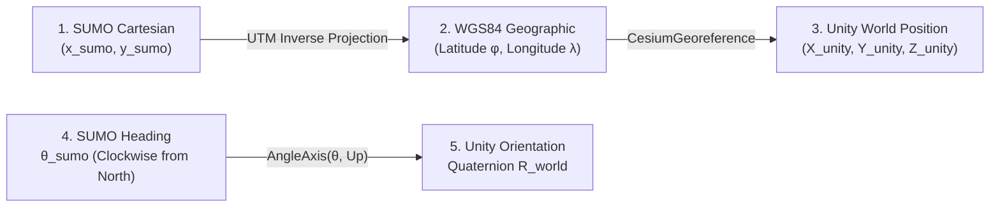
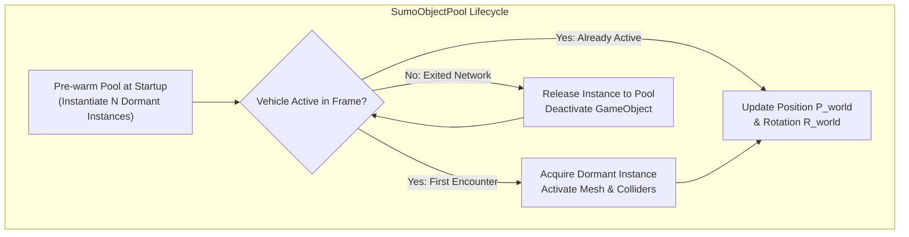

# SUMO traffic simulation integration

The Traffic Simulation System connects the BIO-INTEL-MOB virtual reality environment to SUMO (Simulation of Urban MObility), an open-source suite for microscopic traffic and pedestrian simulation.

SUMO provides the microscopic models for car-following, lane-changing, intersection signal controllers, and pedestrian movement. The system streams vehicle and pedestrian trajectories into Unity so users can evaluate scenarios in VR.



## Process management: `SumoLauncher`

The `SumoLauncher` service component starts and monitors the SUMO process:

- Headless execution: Starts the `sumo` or `sumo-gui` binary as a detached subprocess and passes the target scenario settings:
  ```powershell
  sumo -c scenario.sumocfg --remote-port 1337 --step-length 0.1 --start
  ```

- Scenario artifacts: Loads the street network (`.net.xml`), route flows (`.rou.xml`), and polygon shapes (`.poly.xml`) for the active pilot inspection site.

- Process supervision: Monitors process health, captures stdout and stderr, and terminates the process cleanly when the VR user exits inspection mode.

## Multithreaded asynchronous networking pipeline

Unity runs game logic and rendering on its main thread. Synchronous socket reads or large JSON payloads processed in the render loop can reduce frame rates below the required 90 FPS VR budget.

A three-tier asynchronous pipeline keeps network processing out of the render loop:



### 1. `UdpReceiver` (Dedicated background socket thread)

- Runs continuously on a high-priority background worker thread.

- Binds to a local UDP socket (`UdpClient`) and listens for datagrams asynchronously.

- Remains independent of Unity's rendering frame rate.

### 2. `UdpMessageParser`

- Parses incoming frame datagrams with minimal memory allocation.

- Extracts entity IDs, simulation coordinates $(x_{\text{sumo}}, y_{\text{sumo}})$, speed $v$, vehicle type, and heading angle $\theta_{\text{sumo}}$.

### 3. `MainThreadDispatcher`

- Stores parsed frame structures in a thread-safe `ConcurrentQueue<SimulationFrame>`.

- During Unity's `Update()` loop, it dequeues the latest available frame, discards stale intermediate packets, and passes the data safely to Unity scene objects.

## Geospatial coordinate transformation: `SumoGeoConverter`

SUMO uses a local 2D metric Cartesian coordinate system based on the projected road network. Unity places those entities in a georeferenced 3D space.

`SumoGeoConverter` converts positions from SUMO Cartesian coordinates to WGS84 and then Unity world space. A separate calculation converts each entity's heading to a Unity orientation:



### Mathematical formulations

#### 1. Cartesian to WGS84 geographic

Using the network's Universal Transverse Mercator (UTM) projection parameters $(\lambda_0, \phi_0, k_0, x_0, y_0)$ from the `.net.xml` header:
$$(\phi, \lambda) = \mathcal{T}_{\text{UTM}}^{-1}(x_{\text{sumo}} - x_0, \, y_{\text{sumo}} - y_0)$$

#### 2. WGS84 to Unity world space

The geographic coordinate pair $(\phi, \lambda)$ and local street surface elevation $h$ are passed to `CesiumGeoreference`:
$$\vec{P}_{\text{world}} = \text{CesiumGeoreference.TransformLongitudeLatitudeHeightToUnity}(\lambda, \phi, h)$$

#### 3. Vehicle heading & orientation

SUMO defines the vehicle rotation angle $\theta_{\text{sumo}}$ in degrees clockwise from North ($0^\circ = \text{North}, 90^\circ = \text{East}$).

In Unity's left-handed coordinate system, where $+Z$ is North and $+X$ is East, the 3D rotation quaternion $\mathbf{R}_{\text{world}}$ uses the local ground normal $\vec{U}_{\text{local}}$ as its rotation axis:
$$\mathbf{R}_{\text{world}} = \text{Quaternion.AngleAxis}(\theta_{\text{sumo}}, \, \vec{U}_{\text{local}})$$

## High-performance object pooling architecture

Hundreds of vehicles and pedestrians can enter and leave the street inspection area during a dense urban simulation.

Calling `GameObject.Instantiate()` and `GameObject.Destroy()` for every entity would trigger frequent garbage collection (GC) on the Mono/IL2CPP heap, causing visible hitching in the VR headset.



### Zero-allocation pool mechanics

- Pre-warmed capacity: `VehiclePool` and `PedestrianPool` pre-allocate cars, vans, buses, bicycles, and animated pedestrian avatars.

- Fast lookup table: A `Dictionary<string, PooledAgent>` tracks active vehicle IDs.

- `Acquire(vehicleId, type)`: When an ID first appears in a UDP frame, the system takes an inactive GameObject from the pool queue, enables it, and adds it to the active table.

- `Release(vehicleId)`: When an ID is absent from incoming frames for more than $\Delta t_{\text{timeout}}$, the system deactivates its GameObject and returns it to the dormant queue.

- Result: Active traffic simulation uses zero heap allocations per frame.

## Evaluating urban interventions via simulation

Users can assess street modifications in real time with SUMO:

1. Traffic Calming Interventions: Speed humps or chicane bollards placed in the `StreetWorkspace` can be represented in SUMO through reduced edge speeds or modified lane widths.
2. Pedestrian Crossing Additions: Adding crosswalk assets lets planners trigger pedestrian demand in SUMO and observe vehicle stopping behavior and potential queue build-up.
3. Evidence-Based Co-Design: Citizens and city officials can review simulation feedback before committing to municipal infrastructure investments.
