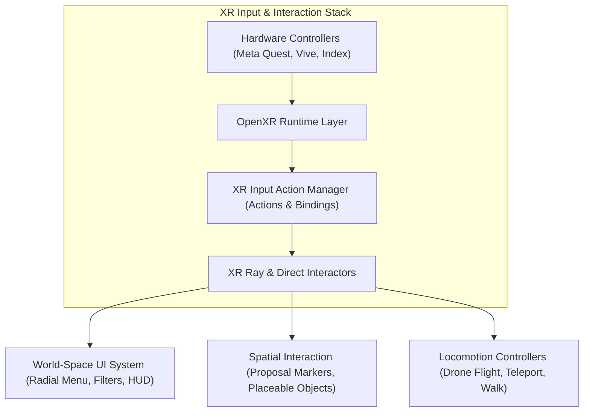
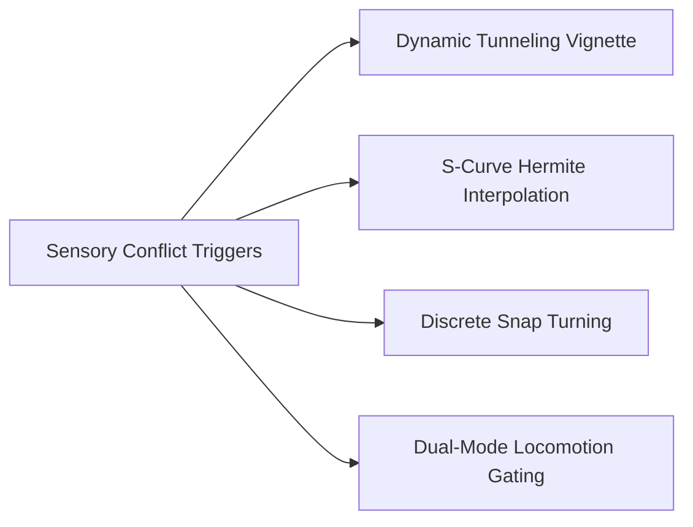
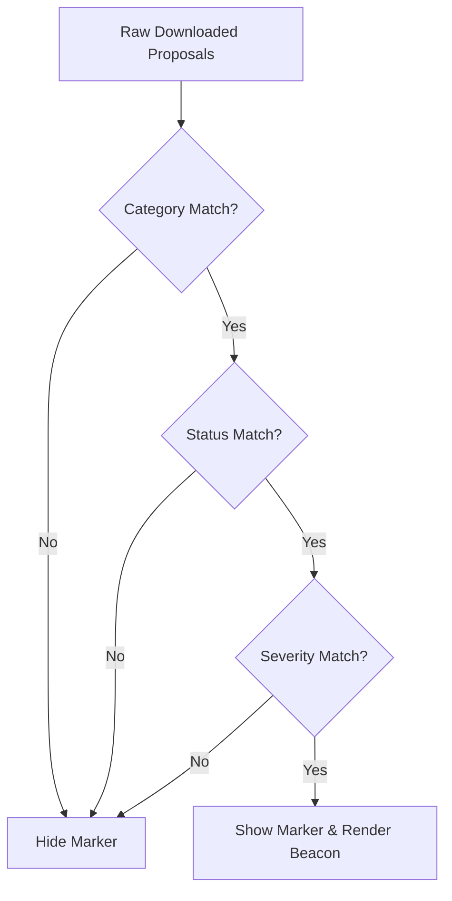

# Unity VR & Interaction Architecture

The **BIO-INTEL-MOB Virtual Reality client** is built on **Unity 6 LTS**, the **OpenXR** standard, and the **Unity XR Interaction Toolkit (XRI)**. 

Because urban digital twins require users to operate across vastly different spatial scales—from macroscopic city overviews down to microscopic street furniture placement—the interaction system is designed to provide maximum immersion while rigorously preventing simulator sickness.



---

## OpenXR & XR Interaction Toolkit Integration

The platform uses the vendor-neutral **OpenXR** specification to ensure seamless cross-platform deployment across standalone headsets (Meta Quest via Oculus Link/AirLink), PC-tethered headsets (HTC Vive, Valve Index), and OpenXR-compliant runtimes.

### Core VR Components
- **`XR Origin`**: Serves as the root anchor of the user's tracking space. It hosts the stereoscopic main camera (tracking head pose in 6-DOF) and left/right controller tracking nodes.
- **`XR Ray Interactor`**: Projects a curved bezier pointer for distant selection (e.g., clicking aerial proposal markers or interacting with world-space UI canvases from a distance).
- **`XR Direct Interactor`**: Enables near-field physical grabbing and manipulation of street objects when inside the inspection workspace.
- **`XR References`**: A centralized singleton cache providing instant, non-allocating access to head transforms, hand interactors, and ray pointers.

---

## Motion Sickness: Physiological Etiology & Countermeasures

Navigating high-density urban 3D environments presents severe motion sickness challenges if locomotion is poorly engineered.

### Sensory Conflict Theory
Virtual reality-induced motion sickness (simulator sickness) arises primarily from **sensory conflict theory** (Reason & Brand, 1975). When a user navigates artificially through a virtual city:
1. The **visual system** perceives high-velocity optical flow (vection), signaling rapid linear acceleration and rotation.
2. The **vestibular system** (specifically the semicircular canals and otolith organs in the inner ear) detects no corresponding physical forces or gravitational tilt.
3. This neurological mismatch between visual acceleration and vestibular inertia triggers the autonomic nervous system, resulting in nausea, oculomotor fatigue, and disorientation.

### Urban Digital Twin Drivers
- **Scale Shifts**: Flying rapidly from a $500\,\text{m}$ orbital view down to ground level generates massive optical flow across the peripheral retina.
- **Continuous Yaw Rotation**: Smooth joystick yaw rotation is notoriously emetogenic because the horizontal semicircular canals expect rotational angular acceleration that never occurs.
- **Ground Proximity Velocity**: The closer the camera is to ground geometry, the higher the angular velocity of passing textures across the field of view.

### Engineering & Architectural Countermeasures

To eliminate sensory conflict, BIO-INTEL-MOB enforces four architectural safeguards:



1. **Dynamic Tunneling Vignette**:
   - During high-velocity camera transitions (such as the landing sequence), the peripheral field of view is dynamically occluded.
   - The vignette constricts over $0.2\,\text{s}$, occluding $65\%$ of the peripheral display with a softened $25\%$ gradient feather. Peripheral vection cues are masked while central foveal focus remains sharp.
   - Upon completing the landing, the aperture smoothly opens over $0.35\,\text{s}$ back to $100\%$ FOV.
2. **Smooth S-Curve Hermite Easing**:
   - Camera relocations avoid sudden linear velocity steps ($C^0$ discontinuities).
   - Trajectories use cubic Hermite easing ($s(t) = 3t^2 - 2t^3$), ensuring zero initial and final velocity ($v(0) = v(1) = 0$), preventing abrupt jerks.
3. **Snap Turning ($45^\circ$ Discrete Intervals)**:
   - Eliminates continuous angular vection. Users rotate in instantaneous $45^\circ$ angular increments with black-frame smoothing.
4. **Dual-Mode Locomotion Gating**:
   - In **City Overview Mode**: Continuous two-handed 3D drone navigation is active for broad spatial exploration.
   - In **Street Inspection Mode**: Drone flight is strictly disabled to prevent accidental disorienting ascents; locomotion is restricted to bounded walking and parabolic teleportation within the workspace perimeter.

---

## VR User Interface Architecture

Conventional screen-overlay UI (such as fixed head-locked HUDs) induces severe **focal rivalry** and **vergence-accommodation conflict** in stereoscopic VR. All interfaces in BIO-INTEL-MOB are rendered as **world-space spatial canvases**.

```text
User Interface Subsystem
├── RadialMenu (Procedural Annular Geometry)
├── MarkerFilterPanel (Multi-Criteria Predicate Pipeline)
├── ProposalDetailsPanel (Contextual Metadata & Media)
└── WorkspaceHUD (Floating Street Co-Design Interface)
```

### 1. Procedural Annular Radial Menu
To allow one-handed access to core tools without cluttering the visual field, the platform features a procedural **VR Radial Menu**:
- **Annular Mesh Generation**: Instead of relying on static bitmap slices, the menu procedurally generates circular arc meshes at runtime based on an inner radius $r_{\text{in}}$, outer radius $r_{\text{out}}$, and segment count $N$:
  $$\theta_i = \frac{2\pi i}{N}, \quad \Delta\theta = \frac{2\pi}{N} - \theta_{\text{padding}}$$
- **Ergonomic Spatial Anchoring**: Spawns $0.65\,\text{m}$ in front of the user's non-dominant controller, rotated slightly toward the user's eye gaze ($\approx 15^\circ$ upward tilt).
- **Dynamic Haptics & Feedback**: Hovering the ray pointer over an annular sector triggers controller micro-vibrations and expands the sector radially.

### 2. Multi-Criteria Marker Filtering Pipeline
To enable exploration of hundreds of civic proposals across an entire metropolis, the `MarkerFilterPanelBuilder` generates an interactive toggle matrix:



- **Category Filtering**: Toggles visibility for *TRANSPORT*, *ENVIRONMENT*, *ACCESSIBILITY*, and *INFRASTRUCTURE*.
- **Status Filtering**: Filters by resolution state (*PENDING*, *APPROVED*, *REJECTED*).
- **Severity Filtering**: Isolates urgent safety issues (*LOW*, *MEDIUM*, *HIGH*).
- **Zero-Roundtrip Client Execution**: The filter predicate is evaluated locally across cached `ProposalMarker` instances, instantaneously updating visibility without network latency.

### 3. Proposal Details Card & Action Dispatching
Hovering or selecting a proposal marker with the XR Ray Interactor opens a world-space metadata card:
- **Header**: Proposal ID, creation date, and status badges.
- **Narrative Content**: Citizen issue description and uploaded photographic evidence.
- **Voting Metrics**: Civic support counter.
- **Bidirectional Action Dispatching**:
  - `Land on Street`: Triggers the `InspectionManager` to begin the Hermite descent.
  - `Return to Overview`: Reverses the transition, bringing the camera rig back to aerial perspective.
