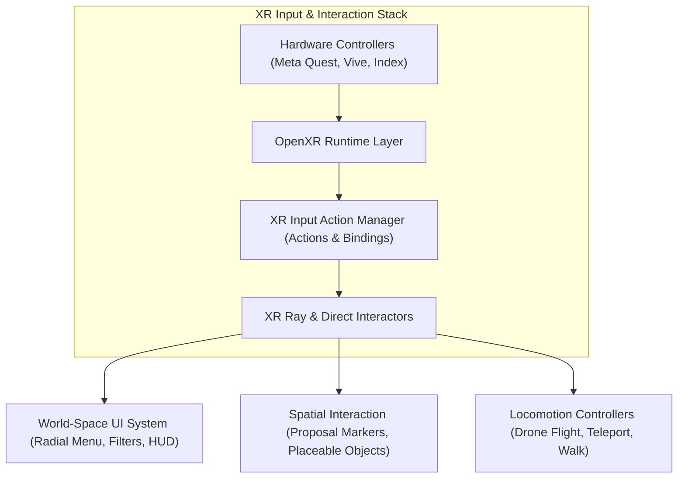
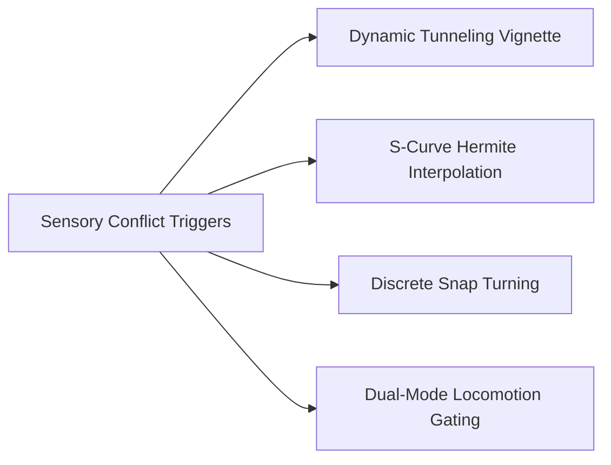
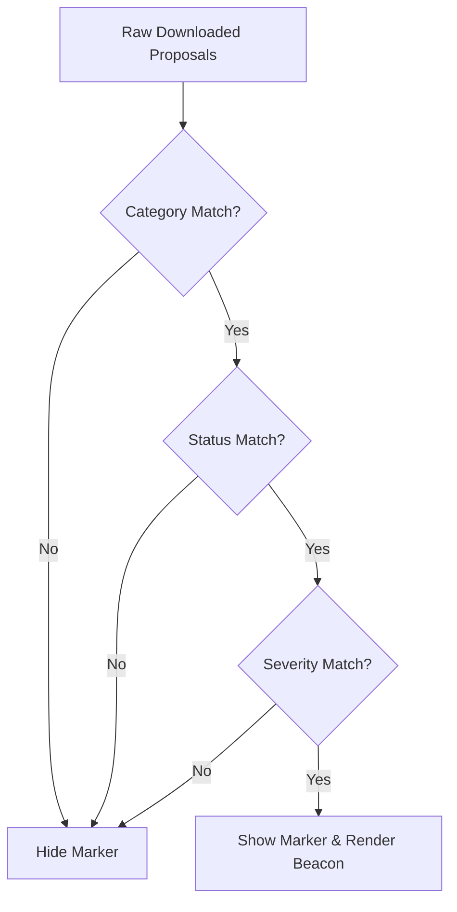

# Unity VR & interaction architecture

The BIO-INTEL-MOB Virtual Reality client uses Unity 6 LTS, the OpenXR standard, and the Unity XR Interaction Toolkit (XRI).

Users move between city-scale overviews and detailed street furniture placement. The interaction system supports these changes in scale with immersive controls and measures to limit simulator sickness.



## OpenXR & XR Interaction Toolkit integration

The vendor-neutral OpenXR specification supports deployment across OpenXR-compliant runtimes, including Meta Quest headsets via Oculus Link/AirLink and PC-tethered headsets such as HTC Vive and Valve Index.

### Core VR components

- `XR Origin`: Anchors the user's tracking space and hosts the stereoscopic main camera, which tracks head pose in 6-DOF, along with left/right controller tracking nodes.

- `XR Ray Interactor`: Projects a curved Bezier pointer for distant selection of aerial proposal markers and world-space UI canvases.

- `XR Direct Interactor`: Supports grabbing and manipulating nearby street objects in the inspection workspace.

- `XR References`: A singleton cache that provides immediate access to head transforms, hand interactors, and ray pointers without memory allocation.

## Motion sickness: causes and countermeasures

Poorly designed locomotion in dense urban 3D environments can cause severe motion sickness.

### Sensory conflict theory

Sensory conflict theory (Reason & Brand, 1975) explains VR-induced motion sickness, also called simulator sickness, through a mismatch between visual and vestibular cues. During artificial movement through a virtual city:

1. The visual system perceives high-velocity optical flow (vection), signaling rapid linear acceleration and rotation.
2. The vestibular system (specifically the semicircular canals and otolith organs in the inner ear) detects no corresponding physical forces or gravitational tilt.
3. The mismatch between visual acceleration and vestibular inertia triggers the autonomic nervous system, causing nausea, oculomotor fatigue, and disorientation.

### Urban digital twin drivers

- Scale Shifts: Flying rapidly from a $500\,\text{m}$ orbital view down to ground level generates strong optical flow across the peripheral retina.

- Continuous Yaw Rotation: Smooth joystick yaw rotation can cause nausea because the horizontal semicircular canals receive no physical angular acceleration to match the visual rotation.

- Ground Proximity Velocity: The closer the camera is to ground geometry, the higher the angular velocity of passing textures across the field of view.

### Engineering & architectural countermeasures

BIO-INTEL-MOB uses four measures to reduce sensory conflict:



1. Dynamic Tunneling Vignette:
   - During fast camera transitions, including landing, the vignette masks the peripheral field of view.
   - The vignette constricts over $0.2\,\text{s}$, occluding $65\%$ of the peripheral display with a softened $25\%$ gradient feather. Peripheral vection cues are masked while central foveal focus remains sharp.
   - Upon completing the landing, the aperture opens smoothly over $0.35\,\text{s}$ back to $100\%$ FOV.
2. Smooth S-Curve Hermite Easing:
   - Camera relocations avoid sudden linear velocity steps ($C^0$ discontinuities).
   - Camera trajectories use cubic Hermite easing ($s(t) = 3t^2 - 2t^3$), ensuring zero initial and final velocity ($v(0) = v(1) = 0$), so movement starts and ends at rest.
3. Snap Turning ($45^\circ$ Discrete Intervals):
   - Eliminates continuous angular vection. Users rotate in instantaneous $45^\circ$ angular increments with black-frame smoothing.
4. Dual-Mode Locomotion Gating:
   - In City Overview Mode: Continuous two-handed 3D drone navigation is active for broad spatial exploration.
   - In Street Inspection Mode: Drone flight is disabled to prevent accidental, disorienting ascents. Users can walk within bounds or use parabolic teleportation inside the workspace perimeter.

## VR user interface architecture

Screen-overlay UI, including fixed head-locked HUDs, can cause focal rivalry and vergence-accommodation conflict in stereoscopic VR. BIO-INTEL-MOB renders all interfaces as world-space spatial canvases.

```text
User Interface Subsystem
├── RadialMenu (Procedural Annular Geometry)
├── MarkerFilterPanel (Multi-Criteria Predicate Pipeline)
├── ProposalDetailsPanel (Contextual Metadata & Media)
└── WorkspaceHUD (Floating Street Co-Design Interface)
```

### 1. Procedural annular radial menu

The procedural VR Radial Menu gives users one-handed access to core tools while keeping the visual field clear:

- Annular Mesh Generation: The menu generates circular arc meshes at runtime from an inner radius $r_{\text{in}}$, outer radius $r_{\text{out}}$, and segment count $N$:
  $$\theta_i = \frac{2\pi i}{N}, \quad \Delta\theta = \frac{2\pi}{N} - \theta_{\text{padding}}$$

- Ergonomic Spatial Anchoring: Spawns $0.65\,\text{m}$ in front of the user's non-dominant controller, rotated slightly toward the user's eye gaze ($\approx 15^\circ$ upward tilt).

- Dynamic Haptics & Feedback: Hovering the ray pointer over an annular sector triggers controller micro-vibrations and expands the sector radially.

### 2. Multi-criteria marker filtering pipeline

The `MarkerFilterPanelBuilder` generates an interactive toggle matrix for filtering hundreds of civic proposals across a city:



- Category Filtering: Toggles visibility for *TRANSPORT*, *ENVIRONMENT*, *ACCESSIBILITY*, and *INFRASTRUCTURE*.

- Status Filtering: Filters by resolution state (*PENDING*, *APPROVED*, *REJECTED*).

- Severity Filtering: Isolates urgent safety issues (*LOW*, *MEDIUM*, *HIGH*).

- Zero-Roundtrip Client Execution: The filter predicate runs locally on cached `ProposalMarker` instances and updates visibility immediately, without a network round trip.

### 3. Proposal details card & action dispatching

Hovering over or selecting a proposal marker with the XR Ray Interactor opens a world-space metadata card:

- Header: Proposal ID, creation date, and status badges.

- Narrative Content: Citizen issue description and uploaded photographic evidence.

- Voting Metrics: Civic support counter.

- Bidirectional Action Dispatching:
  - `Land on Street`: Triggers the `InspectionManager` to begin the Hermite descent.
  - `Return to Overview`: Reverses the transition and returns the camera rig to the aerial perspective.
